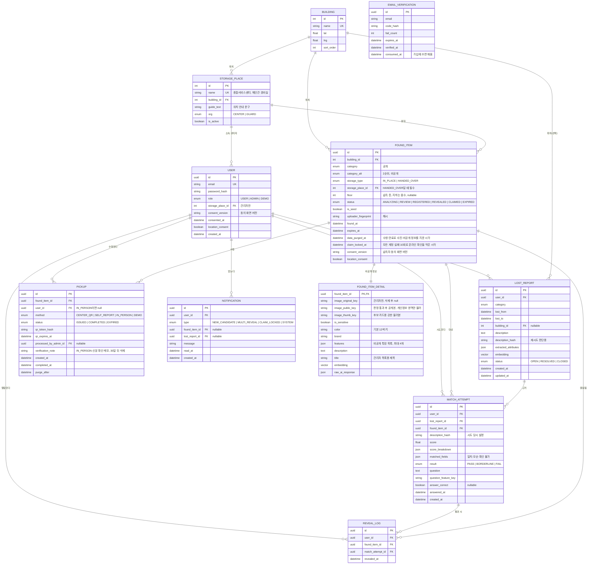

# ERD

> 상태: 초안 (2026-10-11, 검토 반영 2026-10-11). 기준 스택: PostgreSQL + pgvector, Prisma 7.
> 연관 문서: [기능 명세서](./01_기능명세서.md) · [API 명세서](./03_API명세서.md) · [검토 이력](./docs/open-issues.md)
> **실제 스키마는 [`backend/prisma/schema.prisma`](./backend/prisma/schema.prisma)가 기준이다.** 이 문서는 구조와 규칙을 설명한다.

## 1. 설계 원칙

- **공개 정보와 비공개 정보를 테이블로 나눈다.** `found_item`에는 공개해도 되는 것만, `found_item_detail`에는 사진 경로·색·특징·임베딩을 둔다. 실수로 비공개 정보가 응답에 섞이는 걸 구조로 막기 위해서다.
- **습득자 개인정보는 저장하지 않는다.** 등록 남용 방지를 위한 기기·IP 지문만 해시로 남긴다.
- **"누가 찾아갔는지"는 기록 테이블 세 개로 남긴다.** 일치 시도(`match_attempt`), 위치 열람(`reveal_log`), 수령(`pickup`).
- 시드 데이터는 `is_seed` 플래그로 구분해, 화면에 "시연용 데이터"를 표시하고 통계에서 분리한다.
- **체험 계정(`DEMO`)은 기록만 남기고 시드 상태를 바꾸지 않는다.** 체험 계정은 24시간 뒤 관련 기록과 함께 삭제한다.

## 2. 다이어그램



## 3. 테이블 설명

| 테이블 | 역할 | 비고 |
| --- | --- | --- |
| `user` | 분실자, 관리자, 체험 계정 | 저장하는 개인정보는 이메일뿐. 관리자는 `storage_place_id`로 소속 보관처를 가진다 |
| `email_verification` | 가입 인증 코드 | 코드는 해시로 저장, 5분 만료, 확인은 한 번만(`verified_at`). 이미 가입된 이메일 요청도 행을 남겨 발송 제한을 똑같이 건다. 가입하면 `consumed_at`을 채워 같은 가입용 토큰 재사용을 막는다 |
| `building` | 건물 목록과 좌표 | 가장 가까운 건물 추천에 사용(계산은 브라우저에서, 사용자 좌표는 서버로 보내지 않음) |
| `storage_place` | 보관처 (종합서비스센터, 건물별 경비실) | 등록 화면의 보관처 선택, 수령 안내 문구, 관리자 소속 |
| `found_item` | 습득물의 **공개 정보** | 후보 목록·알림은 이 테이블만 읽는다. `category_alt`는 후보 검색에만 쓰고 응답에 넣지 않는다 |
| `found_item_detail` | 습득물의 **비공개 정보** | 일치 판정 통과자, 관리자만 접근 |
| `lost_report` | 분실 신고 | 신고 설명도 같은 속성 체계로 추출·임베딩. 설명을 고치면 `description_hash`가 바뀐다 |
| `match_attempt` | 일치 판정 시도 | 계정·습득물별 실패 횟수로 잠금 판단. 경계 판정이면 확인 질문을 여기 저장 |
| `reveal_log` | 위치 열람 기록 | 상세 조회할 때마다 한 줄씩. 같은 시도로 여러 줄이 생기므로 `match_attempt_id`는 UNIQUE가 아니다 |
| `pickup` | 수령 처리 | 물건당 여러 건 가능(QR 재발급). **완료는 물건당 1건**. 대면 확인 수령(`IN_PERSON`)은 계정 없이 처리 관리자·메모만 |
| `notification` | 앱 내 알림 | 공개 정보만 담는다 |

## 4. 주요 규칙 (DB 수준)

- **잠금 판단** (#29): 실패는 `result = FAIL` 또는 `answer_correct = false`.
  - 계정: `match_attempt`에서 `(user_id, found_item_id)`의 실패가 3 이상이면 그 계정만 잠김. 조회로 계산한다.
  - 물건: 그 물건의 모든 계정 실패가 10이 되면 `found_item.claim_locked_at`을 채운다. 이후 새 판정·답은 막고(대면 확인), 맡은 관리자에게 `CLAIM_LOCKED` 알림을 한 번 만든다. 시드는 제외. 같은 물건의 판정·답은 advisory lock으로 하나씩 처리해 10을 넘지 않는다.
- **재시도**: 같은 `(user_id, found_item_id)`의 마지막 시도와 `lost_report.description_hash`가 같으면 새 시도를 만들지 않고 그 결과를 돌려준다.
- **수령 완료는 물건당 1건**: 부분 유니크 인덱스로 보장한다. 체험 수령(`method = DEMO`)은 시드를 여러 번 수령하므로 제외한다. Prisma 7의 `partialIndexes` 미리보기 기능으로 스키마에 직접 적는다(마이그레이션 SQL에 손으로 넣으면 다음 마이그레이션에서 Prisma가 지우려 한다).
  ```sql
  CREATE UNIQUE INDEX pickup_one_completed_per_item
    ON pickup (found_item_id) WHERE status = 'COMPLETED' AND method <> 'DEMO';
  ```
- **대면 확인 수령** (#29 후속): `claim_locked_at`이 있는 보관 중 물건만. 계정 없는 수령은 대면 확인만, 대면 확인은 처리 관리자·메모 필수(CHECK 제약 `pickup_in_person_check`). 메모는 개인정보라 다른 수령 기록과 같이 `purge_after`(30일 뒤)에 지운다. `claim_locked_at`은 수령 뒤에도 남긴다(잠겼던 기록).
- **QR 재발급**: 같은 사람이 새 QR을 받으면 그 사람의 이전 `ISSUED` 건을 `EXPIRED`로 바꾼다. 완료 처리는 트랜잭션 안에서 물건 상태까지 확인한다.
- **보관처 필수**: Prisma는 CHECK 제약을 표현하지 못해 초기 마이그레이션 SQL 끝에 직접 넣었다.
  ```sql
  ALTER TABLE found_item ADD CONSTRAINT found_item_storage_place_required
    CHECK (storage_type <> 'HANDED_OVER' OR storage_place_id IS NOT NULL);
  ```
- **체험 계정**: 체험 계정의 판정·열람·수령은 `found_item.status`를 바꾸지 않는다. 24시간이 지난 체험 계정은 하루 한 번 배치로 `notification`, `pickup`, `reveal_log`, `match_attempt`, `lost_report`, `user` 순서로 지운다. 일반 계정 기록이 실수로 지워지지 않도록 FK에 CASCADE를 걸지 않고 배치에서 명시적으로 지운다.
- **인덱스**
  - `found_item (category, status, found_at)`: 후보 조회
  - `found_item (category_alt)`: 2순위 종류 후보 조회
  - `match_attempt (user_id, found_item_id)`: 잠금 판단
  - `found_item_detail.embedding`, `lost_report.embedding`: pgvector 인덱스 (데이터가 적은 동안은 생략 가능)
- **삭제** (open-issues #33, 10/12 확정)
  - 수령 완료 직후: 사진 3개와 `found_item_detail`의 비공개 칸·임베딩을 비우고 `found_item.data_purged_at`을 채운다. 실패하면 정기 작업이 다시 지운다.
  - 보관 기한(`expires_at`)이 지난 미수령 물건: `EXPIRED`로 바꾸고 같은 방식으로 지운다. 시드 제외.
  - 기록: `pickup.purge_after`(수령 30일 뒤) 또는 `expires_at` 30일 뒤가 지난 물건의 `reveal_log`, `pickup`, `match_attempt`를 지운다.
  - 정기 작업은 1시간마다 돈다.
- **임베딩 차원**: 사용할 임베딩 모델이 정해지면 `vector(N)`의 N을 맞춘다. 지금 1536은 자리표시값이다. pgvector 인덱스는 2000차원까지만 지원한다.

## 5. 종류(category) 24개

LOST112 기반 서비스 분류(`docs/api/LOST112.md` "우리 서비스 분류")에 우산·텀블러·열쇠·필기구를 따로 둔 24개 (#27, PR #6 리뷰 결정). 열쇠와 자동차 열쇠는 `KEY` 하나로 합쳤다. 코드 기준은 `packages/shared/src/enums.ts`의 `Category`, LOST112 코드는 `CATEGORY_LOST112_CODES`.

`WALLET`(지갑), `ID_CARD`(학생증·신분증), `DRIVER_LICENSE`(운전면허증), `PAYMENT_CARD`(체크·신용카드), `TRANSIT_CARD`(교통카드), `OTHER_CARD`(기타 카드), `PHONE`(휴대폰), `EARPHONE`(무선 이어폰), `SMARTWATCH`(스마트워치), `TABLET`(태블릿), `LAPTOP`(노트북), `CHARGER`(충전기·기타 전자기기), `BAG`(가방), `CLOTHING`(의류), `HAT`(모자), `BOOK`(교재·도서), `GLASSES`(안경·선글라스), `ACCESSORY`(시계·액세서리), `CASH`(현금), `UMBRELLA`(우산), `TUMBLER`(텀블러·물병), `KEY`(열쇠), `STATIONERY`(필기구·필통), `ETC`(기타)

- 옛 10개에서 옮긴 값: `CARD`→`ID_CARD`, `PENCIL_CASE`→`STATIONERY`, `LAPTOP_TABLET`→`LAPTOP`, `CLOTHING_BAG`→`BAG` (마이그레이션 `20261017120000_categories_24`)
- 고가품(`VALUABLE_CATEGORIES`, 보관처·대면 수령 안내): 지갑, 학생증·신분증, 운전면허증, 체크·신용카드, 휴대폰, 무선 이어폰, 스마트워치, 태블릿, 노트북, 시계·액세서리, 현금

### 연관 종류 묶음

후보 검색 때 함께 찾는 종류. 서로 대칭이다. 코드 기준은 `RELATED_CATEGORIES`.

| 종류 | 함께 찾는 종류 |
| --- | --- |
| `WALLET` | 카드·신분증 5종(`ID_CARD`, `DRIVER_LICENSE`, `PAYMENT_CARD`, `TRANSIT_CARD`, `OTHER_CARD`), `CASH` |
| 카드·신분증끼리 | `ID_CARD`↔`DRIVER_LICENSE`, `ID_CARD`↔`OTHER_CARD`, `PAYMENT_CARD`↔`TRANSIT_CARD`↔`OTHER_CARD` (+ 모두 `WALLET`) |
| `CHARGER` | `PHONE`, `EARPHONE`, `SMARTWATCH`, `LAPTOP`, `TABLET` |
| `LAPTOP` ↔ `TABLET` | 서로 (+ `CHARGER`) |
| `SMARTWATCH` ↔ `ACCESSORY` | 서로 |
| `BAG` ↔ `CLOTHING` ↔ `HAT` | 가방↔의류, 의류↔모자 |
| `BOOK` ↔ `STATIONERY` | 서로 |
| `ETC` | 모든 종류 |
| 모든 종류 | `ETC` |
