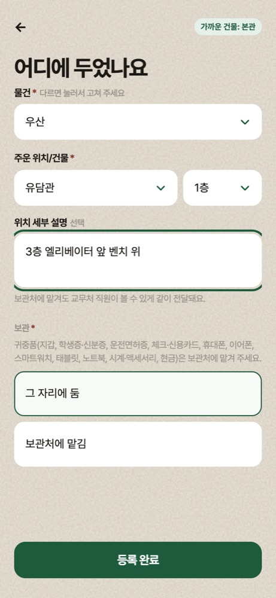
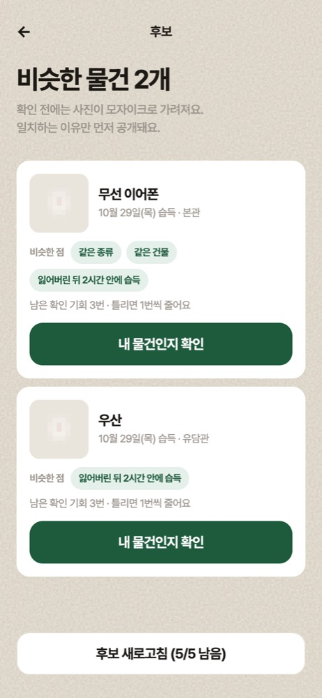
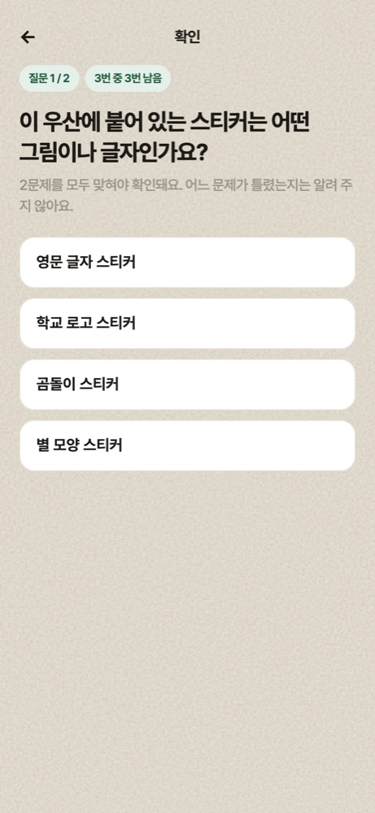
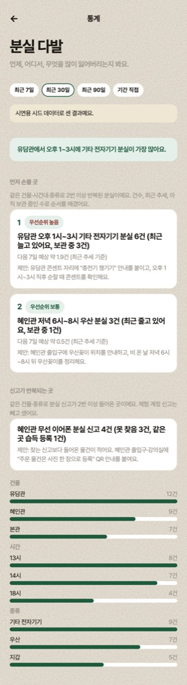
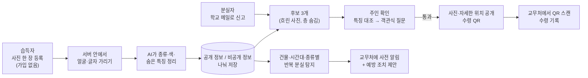

# 찾음표 (chajeumpyo)

> 사진 한 장으로 등록하고, 주인만 아는 특징으로 찾아가는 서경대 캠퍼스 분실물 서비스

- **운영 중인 서비스**: https://chajeumpyo.onrender.com
- **바로 체험하기**: [체험 안내](https://chajeumpyo.onrender.com/guide.html). 가입 없이 체험 계정과 시연용 물건 14개로 습득자·분실자·관리자 흐름을 모두 써 볼 수 있습니다.
- **공모전**: 소웨X전컴 2026 공모전, 주제 "불편이 문제가 되기 전에 AI 기반 캠퍼스 문제 탐지·예측·해결 서비스"
  - 주제를 "분실물 하나가 더 큰 문제(개인정보 노출·사칭·주인을 못 찾음·기록 없음)가 되기 전에"로 풀었습니다.
  - **탐지**: 공개 전에 사진 속 신분증·얼굴을 서버에서 찾아 가리고, 귀중품을 알아봐 보관처를 추천하고, 주인이 아닌 사람(사칭)을 특징 대조로 걸러 냅니다.
  - **예측**: 분실 신고 설명을 AI가 읽어 어느 습득물이 그 사람 것인지 가능성을 매기고 후보 3개로 좁힙니다.
  - **해결**: 확인을 통과한 주인만 위치를 보고, 교무처 QR 수령으로 기록이 남습니다.
  - 보조로 같은 건물·시간대에 반복되는 분실을 규칙으로 집계해 교무처에 알립니다(데이터가 적어 학습 모델 대신 설명 가능한 규칙).

| 습득자: 사진 한 장 등록 | 분실자: 후보 (흐린 사진) | 분실자: 객관식 확인 질문 | 관리자: 먼저 손볼 곳 |
| --- | --- | --- | --- |
|  |  |  |  |

## 팀 스쿠나

| 이름 | 역할 |
| --- | --- |
| 송은열 | 프론트엔드 (화면 설계·구현, 지도, 관리자 화면) |
| 정윤호 | 백엔드 (API·DB, AI 연동, 개인정보 가리기, 매칭·판정, 테스트·배포) |
| 고가빈 | 기획 |
| 송은채 | 디자인 |

## 어떤 문제를 푸나

에브리타임 서경대 게시판에 최근 1년(2025-10-31 ~ 2026-10-29) 분실·습득 글이 **146건**(분실 106, 습득 40) 올라왔습니다.

- 학기 중에는 **한 달 약 18건**, 한 주 2~3건꼴입니다.
- 물건은 **지갑·카드가 70건**으로 가장 많습니다.
- 건물 이름이 나온 글에서는 혜인관 30, 북악관 13, 유담관 11건 순입니다.
- 주운 사람 글 35건을 세 갈래로 나누면 **맡김 21건(60%) · 주운 사람이 보관("쪽지 주세요") 6건(17%) · 그 자리에 둠·안 적음 8건(23%)**이었습니다. 맡긴 곳도 교무처(9건)부터 편의점·카페까지 9곳 이상으로 흩어져 있었고, 어디에 맡기는지 묻는 글도 4건 있었습니다. 그래프: [처리 방법](docs/charts/eta-handling.svg), [맡긴 곳](docs/charts/eta-handin-places.svg)
- 사진이 붙은 글 55건 중 **7건은 신분증·카드의 이름이나 인물 사진이 보이는 상태**로 올라왔습니다. 주인을 찾으려고 올린 사진이 오히려 개인정보를 드러냅니다.

출처는 에브리타임 서경대 게시판 검색("분실·잃어버·습득·주웠")이며 팀이 직접 셌습니다(2026-10-30). 원문과 작성자는 저장하지 않았습니다. 반환 여부는 댓글·쪽지로 오가서 셀 수 없었습니다.

전국으로는 2020년 ~ 2024년 7월 경찰서에 접수된 유실물 495만 5,141건 중 주인을 찾은 비율이 60.4%였습니다(경찰청 자료, [KPI뉴스 2024-09-16](https://www.kpinews.kr/newsView/1065565841134107)).

캠퍼스에는 네 가지 불편이 있습니다.

- 분실물이 교무처·경비실·학과 사무실·커뮤니티 글로 흩어져 있어 어디를 찾아야 할지 모릅니다.
- 교무처에 들어오는 분실물은 한 달 10건 이내로(교무처 전화 문의, 2026-10-30), 학기 중 한 달 약 18건인 커뮤니티 분실·습득 글보다 적습니다. 지금은 신분증과 "어디서 잃어버렸는지"를 직원이 직접 물어 확인합니다. 교무처는 대면 질문이 줄고 수령 기록이 남는 점을 긍정적으로 봤습니다.
- 사진을 그대로 올리면 개인정보가 드러나고, 주인이 아닌 사람이 "제 거예요" 하고 가져가도 막을 수 없습니다.
- 맡기러 가거나 글을 쓰는 일이 번거로워 그냥 두고 갑니다.
- 누가 찾아갔는지 기록이 남지 않습니다.

## 어떻게 해결하나



1. **등록**: 습득자는 가입 없이 사진만 올립니다. 원하면 짧은 물건 설명(선택)을 덧붙일 수 있고, 사진을 AI가 못 읽으면 이 설명으로 종류를 정합니다. 그 자리에 두거나 교무처(혜인관 1층)에 맡깁니다. 귀중품은 막지 않고 가까운 보관처를 추천합니다(그 자리에 두면 교무처에 알림). 캠퍼스 반대쪽 끝인 학술정보관 7층(유담관, 평일 21시·주말 운영)은 두 번째 보관처로 협의 중입니다.
2. **가리기**: 외부 AI로 보내기 전에 서버 안의 작은 모델이 얼굴과 글자(카드번호·이름·학번)를 먼저 가립니다. 가리기에 실패하면 AI로 보내지 않습니다.
3. **AI 분류**: Gemini가 가린 사진에서 종류(24개 큰 종류, 36개 세부 종류), 색, 주인만 알 만한 숨은 특징을 뽑습니다.
4. **후보**: 분실자가 신고하면 종류·장소·시간·설명 유사도로 후보 3개만 보여 줍니다. 후보에는 흐린 사진과 공개 정보만 나옵니다.
5. **주인 확인**: 분실자가 말한 특징을 숨은 특징과 대조합니다. 애매하면 객관식 카드 질문(보통 2문제, 맞힌 특징이 없으면 최대 3문제)을 냅니다. 계정당 3회, 물건당 10회 틀리면 잠깁니다.
6. **수령**: 통과하면 사진·자세한 위치·수령 QR이 열리고, 교무처가 QR을 스캔하면 기록이 남습니다.
7. **예방**: 같은 건물·2시간·종류에 2건 이상 반복된 분실을 찾아 우선순위와 예방 조치를 제안하고, "높음"이 되면 교무처에 미리 알립니다.

**확장**: 다른 학교는 교내 메일 인증 그대로 건물 목록·메일 도메인·보관처 데이터만 바꾸면 되고, 회사·지하철 등 학교 밖 기관은 간편가입(구글·카카오·네이버)으로 넓힐 예정입니다. 운영 데이터가 쌓이면 서비스 안에서 동의받은 과거 확인 사례를 찾아 AI 판정에 함께 넣는 사례 검색(RAG)으로 같은 뜻 판정을 개선할 계획입니다(모델 학습이 아니라 사례 검색).

## AI는 어디에, 규칙은 어디에

| 단계 | 쓰는 것 | 왜 |
| --- | --- | --- |
| 사진 → 물건 정보 (탐지) | AI (Gemini 3.6 Flash, 실패 시 3.5 Flash) | 습득자가 글을 쓰지 않아도 종류·색·특징이 정리돼야 등록이 쉽습니다 |
| AI 전송 전 개인정보 가리기 (탐지) | 서버 안 AI 모델 2개 (얼굴, 글자 영역) | 학생증·카드 사진을 외부로 그대로 보내지 않기 위해서입니다. 한 장에 0.1~0.15초 |
| 후보 고르기 (예측) | AI가 신고 설명을 읽고, 점수식 (종류·장소·시간) + 설명 임베딩 | 어느 습득물이 이 사람 것인지 가능성을 매겨 3개로 좁힙니다. 표현이 달라도 비슷한 설명을 찾되, 어디서 주웠는지를 함께 봅니다 |
| 주인 확인 판정 (사칭 탐지) | **규칙 먼저.** 규칙이 다르다고 본 특징만 AI가 같은 뜻인지 다시 봄 | 같은 입력에는 늘 같은 결과가 나와야 공정하고 설명할 수 있습니다. "곰돌이" ↔ "곰 캐릭터"처럼 같은 뜻 다른 말만 AI로 보완합니다 |
| 확인 질문 보기 | AI (실패 시 준비된 보기) | 정답과 비슷한 오답을 만들어 찍어서 맞히기 어렵게 합니다 |
| 반복 분실 탐지·우선순위·다음 7일 예상 (보조) | **규칙 기반 집계** | 교무처 접수가 한 달 10건 이내라 학습 모델은 믿기 어렵고, 교무처가 "왜 1순위인지"를 바로 알 수 있어야 합니다. 사례가 쌓이면 학습 모델로 바꿉니다. "다음 7일 예상"은 최근 추세를 이어 본 값이며 학습한 예측 모델이 아닙니다 |

## 측정 결과 (정직하게)

숫자마다 무엇으로 쟀는지 함께 적었습니다. 자세한 표와 한계는 [결과보고서 3.8~3.9](docs/결과보고서.md)에 있습니다.

| 무엇을 | 세트 | 결과 |
| --- | --- | --- |
| 종류 인식 | 공개 제품 사진 87장 (흰 배경, 같은 세트로 지시문을 다듬음) | 큰 종류 99% (86/87), 세부 종류 90% (60/67) |
| 종류 인식 | 팀원이 직접 찍은 실제 분실물 사진 35장 (물건 28개) | 큰 종류 34/35, 색 33/35 |
| 후보 3개 안에 정답 | 실제 사진 28개 물건 × 설명 2가지 = 신고 56건 | 54~56/56 (1등 51/56). 경계 색·지갑↔파우치를 고치기 전 52/56. 회색 인형 키링은 얼굴 오탐 때문에 실행에 따라 후보에서 빠집니다 |
| 진짜 주인 통과 | 우리가 만든 시드 14개 × 설명 3가지 | 42/42 |
| 진짜 주인 통과 | 실제 사진 신고 56건 | **52/56** (처음 44/56 → 경계 색·지갑↔파우치 수정 후 51/56, PR #121 → 주인 확인 보안 보강 뒤 52/56, PR #128. 지시문 수정 뒤 새로 찍은 17장만: 32/32) |
| 습득자 물건 설명(선택) | 같은 신고 56건, 설명 한 줄을 보탰을 때 | 후보 3개 안 56/56·1등 55/56 (사진만 54/56·51/56). 사진 분석을 일부러 실패시켜도 설명으로 28개 중 22개를 바로 등록 (설명 없으면 0개, 모두 관리자 검토 대기) |
| 사칭 통과 (틀린 특징) | 우리가 만든 시드 14개 | **0/14** |
| 사칭 통과 (특징 없이 객관식 찍기) | 시드 14개, 보기 수로 정확히 계산 | 계정 하나 **약 7.3%**(시드 14개 물건의 실제 질문 수로 낸 평균. 질문이 1개뿐인 물건은 1/4), 학교 계정 10개로 물건이 잠길 때까지 약 48.5%. 10/30 보강 전에는 보기를 자유 입력으로 적는 우회(1/4)와 다시 시도해 보기를 비교하는 공격이 있어 더 높았습니다. 지금은 객관식에 보기 번호로만 답하고, 같은 물건·같은 질문은 같은 보기 세트를 다시 쓰며, 오답을 정답과 같은 형식으로 만들고, 특징 없는 찍기는 계정·물건마다 한 번이고 설명만 바꿔 찍기 시도를 여러 개 열 수 없습니다(가장 최근 질문에만 답할 수 있음) |
| 개인정보 가리기 | 실제 사진 35장 | 놓친 개인정보 0건 (학생증 뒷면 카드번호·주소·전화 모두 가림). 사람이 없는데 얼굴로 잡아 가린 사진 3장 |
| 개인정보 가리기 | 커뮤니티 실제 사진 42장 중 개인정보가 보이는 7장 (로컬에서만 실행, 외부 전송 없음, 측정 후 삭제) | 다 가린 것 3장, 일부 남은 것 4장 (작은 글자 줄, 세로 글자, 사진 속 사진의 얼굴). 그래서 학생증·신분증·카드로 분류된 물건은 공개 사진 전체를 흐리게 보완했습니다 |
| 임베딩만 쓴 추천과 비교 | 시드 + 헷갈리는 물건 42개, 신고 42건 | 1등: 임베딩만 11/42, 점수식 29/42 (다른 건물의 비슷한 물건을 장소 점수로 걸러냄) |

한계도 있습니다.

- 시드와 분실 설명은 우리가 만들었습니다.
- 실제 사진은 팀원 물건 35장(물건 28개)이고, 분실 설명은 우리가 썼습니다. 52/56·54/56은 이 56건으로 규칙을 고친 뒤 같은 56건으로 다시 잰 값이라, 미리 보지 않은 사진 기준은 새로 찍은 17장(주인 32/32)입니다. 진짜 주인이 떨어진 경우는 대부분 이웃한 색(베이지↔노랑, 남색↔검정)을 다르게 본 것이라 다음에 고칠 점으로 남겼습니다.
- 개인정보를 놓치지 않는 쪽을 택해서, 브랜드 로고나 이니셜도 가려집니다. 그만큼 숨은 특징이 AI에 덜 보입니다.

## 기술 스택

| 영역 | 무엇을 하나 | 사용 기술 |
| --- | --- | --- |
| 화면 | 휴대폰에서 앱처럼 쓰는 웹 화면. 설치·오프라인 화면 지원 | HTML·CSS·JavaScript (프레임워크 없음), PWA, QRCode.js, jsQR |
| 서버 | 등록·판정·수령 API, 입력과 AI 응답 검증 | Node.js 22, Express 5, TypeScript, zod |
| 데이터베이스 | 공개 정보와 비공개 정보를 테이블 단위로 분리, 설명 유사도 검색 | PostgreSQL, pgvector, Prisma 7 |
| AI | 사진 분석, 신고 분석, 확인 질문 보기, 같은 뜻 확인 | Google Gemini 3.6 Flash (실패 시 3.5 Flash), gemini-embedding-001 |
| 서버 안 가리기 | 외부로 보내기 전 얼굴·글자 가리기 | onnxruntime-node, UltraFace(얼굴), PP-OCRv4 det(글자 영역), sharp |
| 보안 | 봇 방지, 요청 제한, 비밀번호 해시, 만료되는 사진 주소 | Cloudflare Turnstile, helmet, express-rate-limit, bcryptjs, 서명 URL |
| 품질 | 자동 테스트, 코드 검사, 키 유출 검사 | Vitest, Biome, GitHub Actions, Gitleaks |
| 배포 | API와 화면을 한 서비스로 | Render (Docker 웹 서비스 + PostgreSQL) |
| 지도 | 캠퍼스맵 그림에 건물 13곳 핀, 위성 사진은 버튼으로 | 네이버 지도 API, Esri 위성 사진(대체) |

한 달 고정비는 Render 공시 가격 기준 **$17.75**(약 ₩2.5만)입니다. Gemini는 쓴 만큼만 내며, 10월 개발·측정 전체가 ₩1,430이었습니다.

## 폴더 구조

```
.
├── backend/              # Express API 서버
│   ├── prisma/           # DB 스키마, 마이그레이션, 시드 데이터(건물·보관처)
│   ├── models/           # 서버 안 가리기용 ONNX 모델
│   ├── scripts/          # 관리자 만들기, 체험 시드, 평가 스크립트(eval:*)
│   ├── src/              # routes → services → repositories, ai/, matching/, privacy/
│   └── test/             # 단위·통합 테스트 (Vitest, 실제 PostgreSQL)
├── packages/shared/      # 화면·서버가 함께 쓰는 zod 스키마와 타입 (API 계약)
├── frontend/             # 화면 (습득자 found/, 분실자 lost/, 관리자 admin/, 체험 안내 guide.html)
├── docs/                 # 결과보고서, 설계·보안·평가 문서, docs/api/openapi.json
│   └── spec/             # 기능명세서, ERD, API명세서
└── qa/                   # QA 통과 기준
```

## 로컬에서 실행하기

필요한 것: Node.js 22.12 이상, Docker

```bash
npm install                    # 워크스페이스 전체 설치 + Prisma 클라이언트 생성
# 루트에 .env를 만든다 (아래 "환경 변수" 참고)
npm run db:up                  # PostgreSQL + pgvector (docker compose)
npm run db:deploy -w backend   # 마이그레이션 적용
npm run db:seed -w backend     # 건물·보관처
npm run seed:demo -w backend   # 체험용 시드 물건 (선택)
npm run dev                    # http://localhost:4000 (화면과 API를 함께 제공)
```

### 환경 변수

루트 `.env`에 둡니다. 키 값은 팀 내부로만 주고받으며 레포에 올리지 않습니다. 목록과 검증 규칙은 [`backend/src/config/env.ts`](backend/src/config/env.ts)에 있습니다.

- 꼭 필요한 것: `POSTGRES_PASSWORD`, `DATABASE_URL`, `JWT_SECRET`(32자 이상), `ALLOWED_EMAIL_DOMAINS`
- 키 없이 띄우기: `AI_MODE=mock`(Gemini 대신 고정 응답), `MAIL_MODE=console`(인증 메일 대신 서버 로그), `CAPTCHA_MODE=off`
- 실제 AI를 쓸 때: `AI_MODE`, `GEMINI_API_KEY`, `GEMINI_MODEL`, `GEMINI_FALLBACK_MODEL`, `GEMINI_EMBED_MODEL`
- 그 밖: `SMTP_*`, `TURNSTILE_*`, `STORAGE_*`, `PUBLIC_BASE_URL`, `FOUND_ITEM_RETENTION_DAYS` 등

### 자주 쓰는 명령

| 명령 | 설명 |
| --- | --- |
| `npm test` | 백엔드 자동 테스트 (같은 Docker DB의 `chajeumpyo_test` 사용) |
| `npm run typecheck` | 타입 검사 |
| `npm run lint` / `npm run format` | Biome 검사 / 자동 수정 |
| `npm run eval:claims -w backend` | 주인 확인 평가 (실제 Gemini) |
| `npm run eval:ranking -w backend` | 후보 순위: 임베딩만 vs 점수식 |
| `npm run eval:photos -w backend -- <사진 폴더> --labels <정답.json> --out <결과 폴더>` | 실제 사진 평가 (사진은 레포 밖에 둠) |
| `npm run eval:categories -w backend` | 종류 인식 평가 |
| `npm run admin:create -w backend -- --email <이메일> --password <비밀번호> [--place <보관처>]` | 관리자 계정 만들기 |
| `npm run openapi -w backend` | `docs/api/openapi.json` 다시 만들기 |

## 테스트와 CI

- 백엔드 자동 테스트 445개: 실제 PostgreSQL에 붙여 API를 호출하는 통합 테스트와, 판정·점수·가리기 단위 테스트로 나뉩니다.
- PR마다 GitHub Actions가 두 가지를 검사합니다. 둘 다 통과해야 머지합니다.
  - **키 유출 검사**: Gitleaks
  - **타입·린트·테스트**
- 운영 배포 뒤에는 습득자·분실자·체험·관리자 흐름을 브라우저로 끝까지 눌러 보는 점검을 돌렸습니다.

## 개인정보 원칙

- **습득자**: 개인정보를 받지 않습니다.
- **분실자**: 학교 이메일만 받습니다. 이름과 학번은 받지 않습니다.
- **외부 AI**: 서버 안에서 얼굴·글자를 가린 사본만 보냅니다. 가리기에 실패하면 보내지 않습니다.
- **공개 사진**: 후보에는 흐린 사진만 보여 줍니다. 주인 확인을 통과해야 민감 영역을 흐린 사진이 열립니다. 카드류는 공개 사진 전체를 흐립니다.
- **위치**: 건물 단위로만 저장합니다. 사진의 위치 정보(EXIF)는 지웁니다. 층과 자세한 위치는 확인을 통과한 사람에게만 보입니다. 습득자 물건 설명은 공개하지 않고, 전화번호·학번 같은 숫자는 저장 전에 지웁니다.
- **숨은 특징**: 서버에서만 비교하고 화면으로 보내지 않습니다.
- **보관 기간**: 수령되면 사진과 비공개 정보를 바로 지웁니다. 수령되지 않은 물건은 30일 뒤 지웁니다. 분실 신고와 일반 계정의 삭제 정책은 운영 전에 정합니다(지금은 체험 계정만 24시간 뒤 지웁니다).
- **키**: 서버 환경변수에만 둡니다.

자세한 내용은 [결과보고서 3.11](docs/결과보고서.md)과 [위협 모델](docs/security/THREAT-MODEL.md)에 있습니다.

## 문서

| 문서 | 내용 |
| --- | --- |
| [docs/결과보고서.md](docs/결과보고서.md) | 결과보고서 원본: 문제 정의, AI 활용, 측정, 구현, 비용, 한계 |
| [기능명세서](docs/spec/01_기능명세서.md) | 기능과 정책 |
| [ERD](docs/spec/02_ERD.md) | 데이터 구조와 DB 규칙 |
| [API명세서](docs/spec/03_API명세서.md) | API (`docs/api/openapi.json`) |
| [docs/demo-scenario.md](docs/demo-scenario.md) | 시연 시나리오 |
| [docs/deploy.md](docs/deploy.md) | 배포 방법 |
| [docs/security/THREAT-MODEL.md](docs/security/THREAT-MODEL.md) | 보호할 자산과 위협별 대응 |
| [qa/CANONICAL-AC-PACK.md](qa/CANONICAL-AC-PACK.md) | QA 통과 기준 |
| [docs/open-issues.md](docs/open-issues.md) | 명세 검토 이슈와 결정 이력 |

## AI 도구 사용

코드 작성과 리뷰에 AI 코딩 도구(Claude Code)를 썼습니다.

팀이 직접 정하고 확인한 것은 다음과 같습니다.

- **정책**: 서비스 흐름, 공개·비공개 정보 경계, 시도 횟수와 잠금, 보관 기간, 보관처를 교무처(지금 운영)와 학술정보관(협의 후 추가) 두 곳 체계로 정한 것
- **판정 기준**: 규칙을 먼저 쓰고 AI는 보조로만 쓰는 판정 방식
- **검증**: 외부 QA 결과를 반영해 고칠지 정한 것, 실제 사진으로 측정해 약점을 찾고 다시 잰 것

AI가 만든 코드는 PR 단위로 CI(테스트·키 유출 검사)를 통과한 뒤 머지했습니다. 사람이 결정할 정책은 PR에 "확인 필요"로 남겨 팀이 정했습니다.
