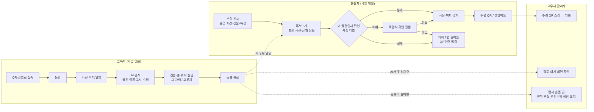
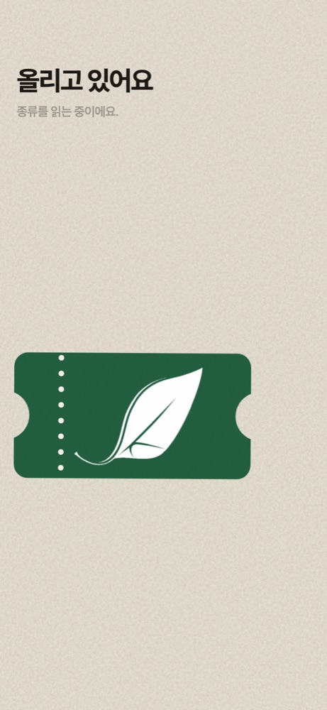
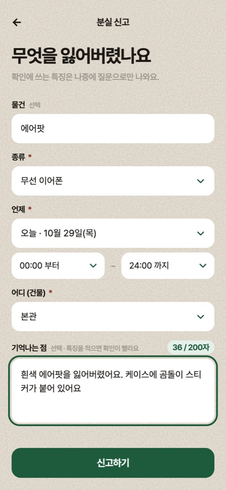
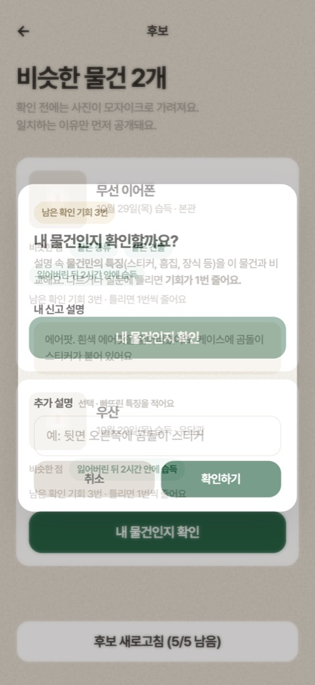
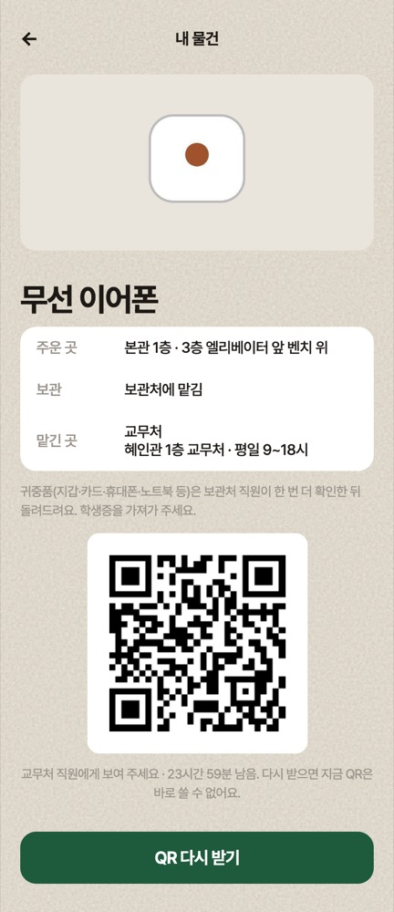
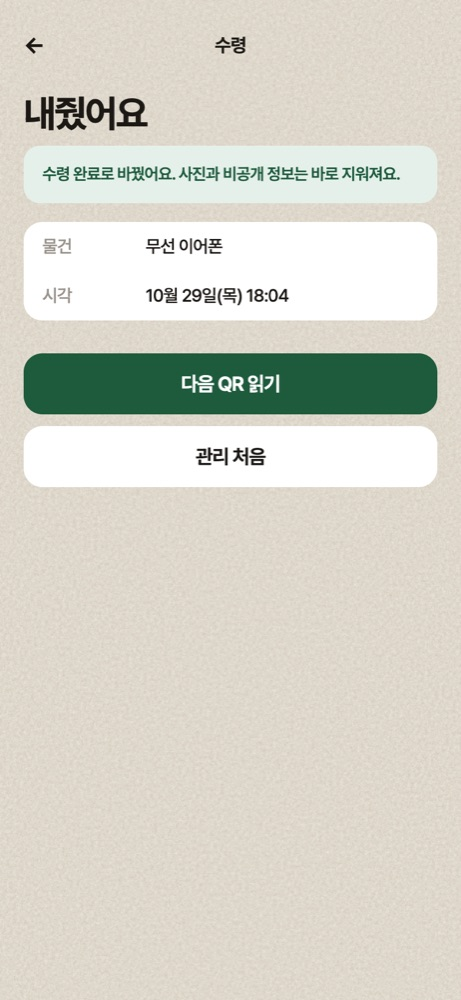
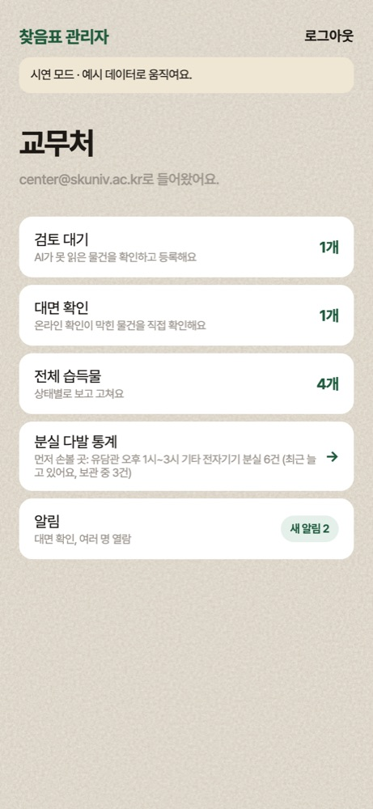
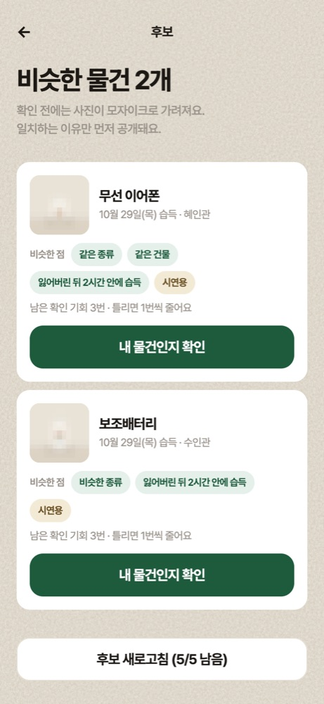
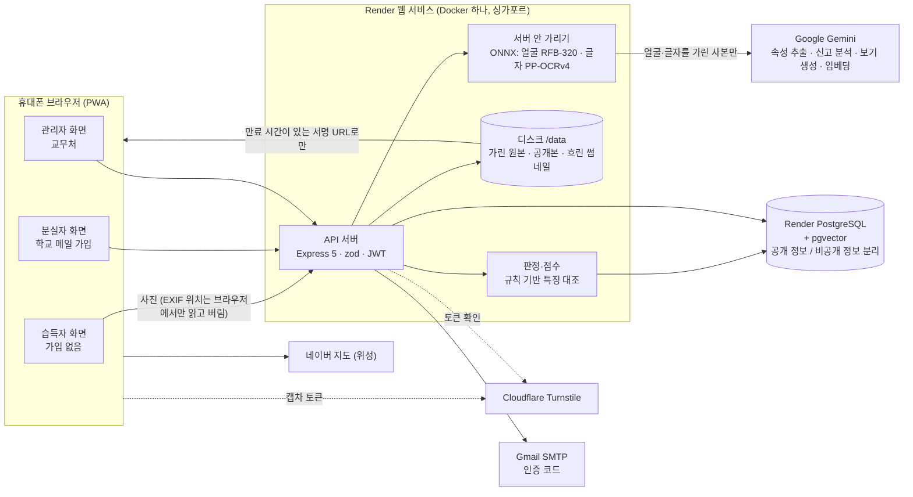

# 찾음표 결과보고서 (작성 중)
> **작성 메모 — 제출 전 이 블록은 삭제한다**
>
> - 이 문서는 제출용 결과보고서의 원본이다. 제출 직전에 Claude로 공모전 양식에 맞춰 다듬는다.
> - `[TODO]`는 아직 채우지 않은 부분, `(초안)`은 회의에서 확정해야 하는 값, `【…】`는 측정·배포 후 채울 값이다. 제출본에 남아 있으면 안 된다.
> - 숫자(성능, 통계, 비용)는 실제로 측정했거나 출처가 있는 것만 쓴다. 추정치를 결과처럼 쓰지 않는다.
> - 근거 문서: `01_기능명세서.md`, `02_ERD.md`, `03_API명세서.md`, `docs/tech-stack.md`, `docs/ai-stack.md`, `docs/matching-weights.md`, `docs/api/LOST112.md`, `qa/CANONICAL-AC-PACK.md`, `docs/security/THREAT-MODEL.md`, `backend/models/README.md`
> - 공모전: 소웨X전컴 2026 · 제출 마감 2026-11-01 · 1차 평가 2026-11-02 ~ 11-09
> - 마지막 갱신: 2026-10-29 저녁 (main, PR #76까지 반영. 운영: Render https://chajeumpyo.onrender.com). 평가표 순서(문제 정의 → AI 활용 → 서비스 기획 → 구현 → 실현·확장)로 장을 다시 묶었다. 자체 채점은 `docs/평가-자체채점.md`.
> - 양식(hwp) 칸에 맞춘 짧은 글은 `docs/결과보고서-양식초안.md`.

---

## 팀 입력이 필요한 것 (한곳에 모음)

> 아래 항목이 남아 있으면 제출본에 넣지 않는다. 본문 해당 위치에도 그대로 있다.

- **2.1 현재 캠퍼스 분실물 처리의 문제**: [TODO] 캠퍼스 근거(교무처 접수·반환 현황, 에타 분실물 글 수, 설문). 전국 근거(경찰청 유실물 495만 건, 반환율 60.4%)는 넣었다.
- **2.2 사용자별 불편**: [TODO] 위 불편마다 근거 숫자를 1개씩 붙인다(아래 2.1 TODO와 같은 자료).
- **3.4 모델 선택 이유**: [TODO] 등록 1건당 평균 비용
- **3.5 일치 판정**: [TODO] 최종 값과 그 근거(튜닝용 데이터에서의 결과)
- **3.7 성능 평가 방법**: [TODO] 튜닝용 / 최종 평가용 분할 방식과 비율
- **3.7 성능 평가 방법**: [TODO] 테스트 세트 구성: 종류별 건수, 촬영 조건, 분실 설명을 누가 어떻게 작성했는지
- **3.8 성능 지표**: 【측정 예정: 홀드아웃 30건 top-3 적중률】
- **3.8 성능 지표**: 【측정 예정】
- **3.8 성능 지표**: 【측정 예정: 테스트 세트 결과】
- **3.9 비교**: [TODO] 로컬 CLIP 기반 단순 유사도 검색(임베딩만 쓴 기준값) 대비 결과. 표나 그래프로 정리한다.
- **3.10 결과 해석**: [TODO] 잘 된 경우와 실패한 경우를 각각 예시로 든다. 오공개 사례가 있었다면 원인과 대응도 쓴다.
- **4.3 화면**: 자동 점검 화면은 넣었다. QA 수정 뒤 실제 휴대폰 캡처로 바꾸기.
- **4.4 플랫폼 선택 이유**: [TODO] 학교 이메일 알림(F-13 확장)을 구현하면 Capacitor 문장 앞에 추가: "또한 iOS에서는 홈 화면에 추가한 경우에만 웹 푸시가 동작하는 한계를 보완하기 위해, 새 후보 습득물이 등록되면 앱 내 알림과 함께 분실자의 학교 이메일로도 알린다." (10/28 현재 메일
- **4.5 기술 스택**: [TODO] `docs/tech-stack.md`를 실제 구성으로 고칠지 팀 확인
- **5.4 시연 영상 시나리오 (2분 30초 안팎)**: 【팀 근거 자료】
- **6.1 기대 효과**: [TODO] 측정값이나 근거가 있는 것만 남긴다.
- **6.1 기대 효과**: 【측정 예정: 등록에 걸린 시간】
- **6.2 차별점**: [TODO] 비슷한 기존 서비스(LOST112, 다른 학교 분실물 서비스 등)와의 비교를 근거와 함께 추가한다.
- **6.3 운영 방식과 비용**: [TODO] Render 요금제 공시 가격으로 한 달 고정비를 계산해 출처와 함께 적는다.
- **6.4 한계**: [TODO] 실제 운영 데이터가 있으면 수정
- **7.1 역할 분담**: [TODO] (git 기록 기준: 습득자·분실자 화면, 팔레트·디자인 반영) |
- **7.1 역할 분담**: [TODO] (git 기록 기준: API 서버·DB, AI 연동, 개인정보 가리기, 매칭·판정, 테스트·CI, 습득자 화면 백엔드 연결, PWA) |
- **7.1 역할 분담**: [TODO] |
- **7.3 협업 방식**: [TODO] 회의 주기
- **8. 오픈소스와 외부 데이터 출처**: [TODO] 제출 직전 `package.json`과 화면 코드 기준으로 다시 확인한다. (Leaflet, Recharts, Lucide, React, shadcn/ui, Tailwind CSS는 처음 계획에 있었지만 현재 코드에서 쓰지 않아 뺐다. 관리자 화면 등에서 새로 쓰면 다시 넣
- **9. PPT 목차 초안 (평가 항목 대응)**: 【팀 근거】
- **부록**: [TODO] 테스트 세트 목록과 평가 스크립트 (`qa/`)

## 0. 발표용 핵심 메시지

1. **사진 한 장이면 등록 끝.** 주운 사람은 가입 없이 사진만 올리고, AI가 물건 종류·색·주인만 알 만한 숨은 특징을 정리한다.
2. **사진은 AI보다 먼저 서버가 가린다.** 얼굴·학생증·카드 글자를 서버 안 모델이 먼저 덮은 사본만 외부 AI로 보내고, 저장 원본도 가린다.
3. **주인은 "주인만 아는 것"으로 증명한다.** 설명의 특징이 숨겨진 정보와 맞아야 사진과 위치가 열리고, 애매하면 객관식 확인 질문, 틀리면 횟수 제한.
4. **반복되는 분실을 먼저 찾아 막는다.** 건물·시간대·종류로 반복된 분실 구간을 찾아 우선순위와 예방 조치(안내문·순찰)를 관리자에게 제안한다.
5. **지금 바로 쓸 수 있다.** 운영 주소에서 심사위원이 가입 없이 체험할 수 있고, 교무처 한 곳이 QR로 돌려주며, 10월 운영비는 Gemini ₩1,430·Render $0.40이었다.

## 1. 작품 개요

| 항목 | 내용 |
| --- | --- |
| 작품명 | 찾음표 (chajeumpyo) |
| 한 줄 소개 | 사진 한 장으로 등록하고, 주인만 아는 특징으로 찾아가는 캠퍼스 분실물 웹앱 |
| 형태 | 모바일 우선 웹앱(PWA). 홈 화면에 추가하면 앱처럼 열리고, 연결이 끊기면 오프라인 안내 화면을 보여 준다 |
| 대상 | 서경대학교 (학교 이메일 `@skuniv.ac.kr`, 캠퍼스 건물 13곳) |
| 시연 링크 | https://chajeumpyo.onrender.com (분실자 화면의 "체험해 보기"로 가입 없이 체험, 관리자 화면은 `/admin/login.html`의 "시연으로 둘러보기") |
| 소스 코드 | https://github.com/songeunyeol/chajeumpyo (공개) |
| 팀 | 송은열(프론트엔드), 정윤호(백엔드), 고가빈(기획), 송은채(디자인) |

## 2. 문제 정의 〔평가: 문제 정의의 명확성 25〕

### 2.1 현재 캠퍼스 분실물 처리의 문제

- 분실물이 종합서비스센터, 경비실, 단과대 사무실, 커뮤니티 게시글 등으로 흩어져 있어 분실자가 어디를 찾아야 할지 모른다.
- 커뮤니티에 사진을 그대로 올리면 학생증·카드의 개인정보가 노출되고, 주인이 아닌 사람이 가져갈 위험이 있다.
- 습득자 입장에서는 물건을 맡기러 가거나 글을 쓰는 과정이 번거로워, 그냥 두고 가는 경우가 많다.
- 누가 물건을 찾아갔는지 기록이 남지 않아, 잘못 수령해도 확인할 방법이 없다.

**전국 근거 (공개 자료)**: 2020년~2024년 7월 전국 경찰서에 접수된 유실물은 495만 5,141건이고, 주인을 찾은 비율은 60.4%였다. 10건 중 4건은 주인에게 돌아가지 못했고, 이 기간 국고로 넘어간 유실물은 약 41만 건, 176억 원어치다. (경찰청 "2020년~2024년 7월 유실물 현황", 박정현 의원실 공개, [KPI뉴스 2024-09-16](https://www.kpinews.kr/newsView/1065565841134107)) 물건이 모이는 곳이 따로 있어도 잃어버린 사람과 이어지지 않으면 돌아가지 못한다는 뜻이고, 창구가 여러 곳으로 흩어진 캠퍼스는 이 연결이 더 약하다.

[TODO] 캠퍼스 근거를 넣는다. 예: 교무처(또는 종합서비스센터) 분실물 접수·반환 현황, 에브리타임 분실물 게시글 수(최근 1~3개월), 학생 설문 결과. 출처를 반드시 함께 적는다.

### 2.2 사용자별 불편

| 사용자 | 지금의 불편 | 찾음표가 바꾸는 것 |
| --- | --- | --- |
| 주운 사람 | 맡기러 가거나 글을 쓰는 일이 번거로워 그냥 두고 감 | 가입 없이 사진 한 장, AI가 정보 정리, 건물 자동 추천 |
| 잃어버린 사람 | 어디에 맡겨졌는지 몰라 여러 곳을 돌거나 게시판을 뒤짐 | 신고하면 후보가 자동으로 뜨고, 새 물건이 들어오면 알림 |
| 물건 주인(개인정보) | 커뮤니티에 사진이 그대로 올라가 이름·학번·카드번호 노출 | 공개 전·AI 전송 전에 서버에서 가림, 확인 전에는 흐린 사진만 |
| 보관처(교무처) | 누가 가져갔는지 기록이 없고, 주인 확인을 말로만 함 | 주인 확인을 서버가 먼저 하고, QR 수령으로 기록이 남음 |
| 학교 운영 | 같은 곳에서 분실이 반복돼도 모아 보는 사람이 없음 | 반복 분실 구간과 우선순위, 예방 조치 제안 |

[TODO] 위 불편마다 근거 숫자를 1개씩 붙인다(아래 2.1 TODO와 같은 자료).

### 2.3 해결 방향

1. **등록은 최대한 쉽게**: 습득자는 가입 없이 사진 한 장과 보관 위치만 고른다. 물건 정보는 AI가 사진에서 뽑는다. 사진을 먼저 분석해 물건 이름을 보여 주고, 위치를 고른 뒤 확정하는 두 단계로 나눠, 습득자가 위치를 고르는 동안 분석이 끝나게 했다.
2. **공개는 최소한으로**: 확인 전에 누구나 볼 수 있는 정보는 종류(세부 종류 포함), 날짜, 건물, 강하게 흐린 작은 사진뿐이다. 선명한 사진과 세부 특징, 층·자세한 위치는 숨긴다. 사진 속 얼굴과 카드·학생증 글자는 외부 AI로 보내기 전에 서버에서 먼저 가린다.
3. **주인 확인은 주인만 아는 정보로**: 분실자가 적은 특징(스티커, 흠집, 안에 든 것)이 숨겨진 정보와 맞아야 사진과 보관 위치가 열린다.
4. **기록은 남긴다**: 위치를 열어 본 계정과 수령한 계정을 기록해, 물건을 가져간 사람을 특정할 수 있게 한다. 기록은 정해진 기간이 지나면 지운다.

### 2.4 공모전 주제 적합성 (탐지·예측·해결)

> 공모전 주제: **"불편이 문제가 되기 전에 AI 기반 캠퍼스 문제 탐지·예측·해결 서비스 기획 및 개발"**
> 공모전 목적: "캠퍼스 불편사항을 단순히 신고하는 수준을 넘어, AI와 소프트웨어 기술을 활용하여 문제를 자동 분류하고, 반복 민원을 탐지하며, 해결 우선순위를 제안하는 서비스" (공모전 OT 자료)

찾음표는 주제 범위 중 "행정 문제"(분실물 처리 창구가 흩어짐)와 "커뮤니케이션"(처리 현황 미공개, 같은 문제 반복)에 해당하는 캠퍼스 분실물 문제를 다룬다.

- **탐지**: AI가 사진에서 물건의 종류(24개 대분류 + 10개 대분류 아래 36개 세부 종류)·색·브랜드·특징을 탐지한다. 개인정보 탐지는 두 겹이다. ① 서버 안의 작은 감지 모델 두 개가 얼굴과 글자 영역(카드번호·학번·이름)을 찾아 외부 AI로 보내기 전에 가리고, ② 외부 AI가 알려 준 민감 영역을 공개용 사진에서 한 번 더 흐린다.
- **판별**: 분실자의 설명과 습득물의 숨은 특징을 서버에서 하나씩 비교해 진짜 주인인지 판별한다. 애매하면 분실자가 적지 않은 숨은 특징을 객관식 카드로 한 번 더 묻는다(최대 2문제, 모두 맞혀야 통과).
- **예측**: 최근 30일의 등록을 건물·2시간 단위 시간대·종류별로 모아 분실이 몰리는 구간을 보여 주고, 관리자가 안내문 부착이나 순찰 등 예방 조치를 할 수 있게 한다. (F-15 분실 다발 카드. 데이터가 적으면 "데이터가 적다"고 안내하고, 시드 데이터로 만든 집계는 따로 표시한다)
- 미수령 위험 표시(F-17)는 아직 구현하지 않았다(P1).

| 공모전이 요구한 것 | 찾음표 기능 | 근거 위치 |
| --- | --- | --- |
| AI로 자동 분류 | 사진 → 24개 종류·36개 세부 종류·색·숨은 특징 (공개 사진 87장 큰 종류 99%, 세부 90%) | 3.2, 3.8 |
| 탐지 | 물건 탐지·분류, 사진 속 개인정보(얼굴·글자) 탐지 후 가리기, 반복 분실 구간 탐지 | 3.2, 3.3, 3.6 |
| 반복 민원 탐지 | 건물 × 2시간 × 종류로 2건 이상 반복된 분실 구간, 건물 × 종류로 2번 이상 들어온 분실 신고 | 3.6 |
| 해결 우선순위 제안 | 건수·최근 추세·보관 중인 수로 높음/보통/낮음, 종류별 예방 조치 | 3.6 |
| 예측 | 분실이 몰리는 구간, 최근 늘어나는지(기간 앞뒤 절반 비교), 다음 7일 예상 건수(최근 추세 기준)로 미리 안내. 학습한 예측 모델은 아직 없다 | 3.6, 6.4 |
| 해결 | 후보 추천 → 주인 확인 → 교무처 QR 수령·기록 | 3.5, 4.1 |

## 3. AI·소프트웨어 활용 〔평가: AI·소프트웨어 활용성 25〕

### 3.1 AI를 어디에, 왜 썼나

| 단계 | 쓰는 것 | 왜 이 방법인가 |
| --- | --- | --- |
| 사진 → 물건 정보 | Gemini 3.6 Flash (실패 시 3.5 Flash) | 습득자가 글을 쓰지 않아도 종류·색·숨은 특징이 정리돼야 등록이 쉬워진다. JSON 형식을 강제해 정해진 값만 받는다 |
| AI 전송 전 개인정보 가리기 | 서버 안 ONNX 모델 2개 (얼굴, 글자 영역) | 학생증·카드가 든 사진을 외부 AI로 그대로 보내지 않기 위해. 서버 안에서 0.1~0.15초 |
| 분실 신고 → 특징 | Gemini | 분실자가 자유롭게 쓴 설명에서 종류·색·특징을 뽑아야 대조할 수 있다 |
| 후보 고르기 | gemini-embedding-001 + pgvector, 장소·시간·종류 점수 | 표현이 달라도("곰 스티커" ↔ "테디베어") 비슷한 설명을 찾기 위해. 임베딩은 보조 신호(비중 0.1)로만 |
| 주인 확인 (특징 대조·판정) | **규칙 먼저, 규칙이 모순이라 본 특징만 Gemini가 다시 봄** | 같은 입력에 늘 같은 결과가 나와야 공정하고 설명할 수 있다. 다만 같은 뜻 다른 말("곰돌이" ↔ "곰 캐릭터")은 규칙이 못 알아봐서 그 경우만 AI로 보완(평가로 확인, 3.8) |
| 확인 질문 보기 | Gemini (실패 시 준비된 보기) | 정답과 길이·말투가 비슷한 오답을 만들어 찍어서 맞히기 어렵게 |
| 서술형 답 판정 | 규칙 먼저, 애매할 때만 Gemini | 동의어("곰돌이" ↔ "곰 캐릭터")를 알아보기 위해. 답은 데이터로만 넘겨 지시문 주입을 막는다 |
| 반복 분실 탐지·우선순위 | **규칙 기반 집계** | 데이터가 적은 초기에는 모델보다 설명 가능한 집계가 맞다. 데이터가 쌓이면 예측 모델로 바꿀 수 있다 |

### 3.2 사진 속성 추출

- 사진 한 장에서 종류·세부 종류(공개), 2순위 종류(후보 검색용), 색·브랜드·숨은 특징 최대 4개·설명문(비공개), 민감 정보 포함 여부와 그 영역을 JSON으로 뽑는다.
- 세부 종류는 나누는 의미가 큰 10개 대분류에만 붙였다. 예: 기타 전자기기 → 충전기·케이블, 보조배터리, 마우스, 키보드 등. 가방 → 백팩, 에코백, 파우치 등. 큰 종류 24개와 경찰청 LOST112 분류 코드 매핑은 그대로 둔다. AI가 큰 종류에 속하지 않는 세부 종류를 보내면 비워 둔다.
- 모델 응답 형식을 먼저 고정해, 모델을 바꾸더라도 서버 코드는 바뀌지 않게 했다. 응답은 서버에서 스키마로 다시 검증하고, 허용값 밖의 종류·색·특징이 오면 실패로 본다. 사진 속 글자로 다른 값을 유도하는 공격도 이 검증에서 걸러진다.
- 분석에 실패하면 한 번 재시도하고, 그래도 실패하면 `검토 대기`로 저장해 관리자가 확인한다. 습득자에게는 등록이 된 것으로 안내한다.
- 건물은 AI가 판단하지 않는다. 브라우저 위치로 300m 안에서 가장 가까운 건물을 추천하고 습득자가 고친다. 좌표는 브라우저 안에서 건물로 바꾼 뒤 버리고 서버로 보내지 않는다. 사진 파일 속 위치 정보(EXIF)는 서버에서 지운다.

### 3.3 AI로 보내기 전 개인정보 가리기

외부 AI(Gemini)에 원본 사진을 그대로 보내지 않기 위해, 서버 안에서 먼저 가린다.

- **얼굴**: Ultra-Light-Fast-Generic-Face-Detector RFB-320 (MIT, 약 1.2MB)
- **글자 영역**: PaddleOCR PP-OCRv4 글자 영역 감지 모델 (Apache-2.0, 약 4.7MB). 글자를 읽지 않고 자리만 찾는다.
- 찾은 영역을 회색으로 덮은 사본만 AI로 보내고, 공개본과 후보용 블러본도 이 사본으로 만든다. 사진은 서버 밖으로 나가지 않는다.
- **가리기에 실패하면** 원본을 AI로 보내지 않는다. AI 분석 없이 `검토 대기`로 저장하고 공개본은 전체를 흐린다.
- 처리 시간은 사진 한 장에 약 0.1~0.15초다 (10/27 시험, 8.2).
- 관리자용 원본도 가린 사본으로 저장한다(10/29 팀 결정, QA B3 "저장 전에 가린다", PR #64). 가리기에 실패한 사진만 원본 그대로 저장하되, AI로 보내지 않고 `검토 대기`로 두어 관리자만 본다.
- 물건 몸체가 글자로 잘못 잡혀 통째로 가려지는 일을 막는 규칙을 넣었다. 예: 검정 뿔테 안경 테 전체가 글자 영역으로 덮여 학생증으로 분류되던 문제(PR #58). 사진의 5% 넘게 차지하고 속이 60% 넘게 찬 덩어리는 글자가 아니라 물건으로 본다.

### 3.4 모델 선택 이유

| 후보 | 판단 |
| --- | --- |
| Gemini 3.6 Flash | 채택. 무료 티어가 있고 JSON 형식 출력 강제가 가능. 10/26 같은 키로 3번씩 시험했을 때 3.x 중 응답이 가장 안정적(2.7~3.6초). 생각 정도는 `MINIMAL`로 낮춰 쓴다(아래) |
| Gemini 3.5 Flash | 실패 시 폴백 (같은 시험에서 2.9~13.8초) |
| Gemini 2.5 Flash 계열 | 새로 만든 API 키에서는 쓸 수 없어(10/26 확인) 제외 |
| GPT-4o | 성능은 충분하나 비용이 크게 높음 |
| YOLO 계열 | AGPL 라이선스 문제, 그리고 종류만 알 뿐 세부 특징 설명이 어려움 |
| 로컬 CLIP | 보고서용 비교 기준(베이스라인)으로만 사용 |

- 무료 티어는 사용자가 몰릴 때 같은 모델도 503 오류나 10~20초 지연이 생겼다. 그래서 시연과 운영은 유료 등급으로 바꿨다. 유료 등급에서 사진 87장을 재 보니, 모델 기본 설정(생각 많음)은 AI 호출 중앙값 5.8초·최대 14.6초였고, 생각 정도를 `MINIMAL`로 낮추자 중앙값 2.6초·최대 5.2초로 줄면서 정확도는 오히려 조금 올랐다(큰 종류 95%→99%, 세부 종류 85%→90%, 지시문 보완 포함, 10/29).
- **실제 비용 (10/29 대시보드 확인)**
  | 항목 | 기간 | 금액 |
  | --- | --- | --- |
  | Gemini API (Google Cloud 결제) | 10/1~10/29 (유료 결제는 10/28부터) | ₩1,430 |
  | Render 서버(웹 서비스·디스크) | 10월 사용분 (10/29 배포 시작) | $0.16 |
  | Render PostgreSQL | 10월 사용분 | $0.24 |
  | Render 합계 | 10월 사용분 / 10월 예상 | $0.40 / $1.92 |
- 개발·시연 기간 비용은 위가 전부다. 정확도 측정(사진 87장 여러 번)과 개발 중 시험 호출이 대부분이라, 실제 등록 1건당 평균 비용은 운영 호출 수가 쌓인 뒤 따로 계산한다. [TODO] 등록 1건당 평균 비용
- Google Cloud 예산 알림(₩30,000, 50·90·100%)을 걸어 비용이 튀면 바로 알 수 있게 했다. 시연 중 AI가 멈추지 않도록 지출 상한은 걸지 않았다.

### 3.5 일치 판정

분실자가 후보 하나를 골라 "내 물건인지 확인"을 누르면, 서버가 분실 신고와 습득물의 비공개 정보를 비교한다.

- **후보 고르기**: 텍스트 유사도(임베딩), 속성 일치, 장소 근접도, 시간 근접도를 합산한 점수로 상위 3개를 고르고, 화면에는 습득 날짜순으로 보여준다. 점수 순서가 드러나지 않게 하기 위해서다. AI가 종류를 헷갈릴 수 있어 2순위 종류와 연관 종류 묶음(지갑↔카드·신분증, 가방↔의류 등)까지 후보로 찾는다.
- **후보에 보이는 것**: 종류(세부 종류), 습득 날짜, 건물, 강하게 흐린 작은 사진, 공개 정보로만 만든 근거("같은 종류", "같은 건물" 등)뿐이다. 층과 자세한 위치는 판정을 통과한 뒤에만 보인다.
- **특징 대조**: 분실자가 적은 특징을 저장된 비공개 특징과 하나씩 비교해 일치 / 모순 / 확인 불가로 나눈다. "스티커"처럼 종류만 적으면 확인 불가, "곰돌이 스티커"처럼 값까지 맞아야 일치다. AI가 특징 종류를 다르게 붙여도(예: "무늬" ↔ "기타") 내용이 같으면 일치로 본다(PR #63). 색·브랜드는 모순 판정에만 쓴다.
- **통과**: 특징 일치 1개 이상, 모순 0개. **실패**: 일치 0개, 모순 1개 이상. **경계**: 일치와 모순이 함께 있거나, 설명에 확인할 특징이 없으면(일치 0·모순 0) 확인 질문을 한다. 물어볼 숨은 특징이 남아 있지 않으면 실패.
- **확인 질문 (객관식, PR #66)**: 처음에는 서술형으로 답을 받았지만, 같은 뜻을 다르게 쓰면 맞히기 어렵다는 팀 의견으로 카드 선택으로 바꿨다. 설명 대조(1단계)는 서술형 그대로다.
  - 분실자가 적지 않은 숨은 특징을 묻고, 하나뿐이면 신고에 색을 적지 않았을 때 색을 함께 묻는다. 최대 2문제, 보기 4개, 모두 맞혀야 통과하므로 찍어서 통과할 확률은 1/16이다. 틀리면 기회가 1번 줄고, 어느 문제가 틀렸는지 알려주지 않는다.
  - 보기는 Gemini가 정답을 짧게 다듬고 비슷한 길이·말투의 오답 3개를 만든다. 길이로 정답이 티 나지 않게 하기 위해서다. AI가 실패하면 미리 준비한 보기를 쓴다.
  - 정답과 낱말이 겹치는 오답, 헷갈리는 이웃 색(흰색↔회색 등)은 보기에서 뺀다. 다른 습득물의 숨은 특징은 오답으로 쓰지 않는다.
  - 정답 위치는 서버에만 저장하고 응답에 넣지 않는다. 같은 설명으로 다시 확인하면 같은 보기를 같은 순서로 보여 준다.
  - 마지막 안전장치로 교무처가 수령 QR과 실물을 확인한다.
- 특징을 잔뜩 나열하는 방식으로는 통과할 수 없고, 아무 값이나 적으면 모순이 쌓인다. 실패할 때는 어떤 항목이 맞았는지 알려주지 않는다.
- **시도 제한**: 한 계정은 한 물건에 3번 틀리면 잠긴다. 한 물건에 모든 계정의 실패 합계가 10번이 되면 온라인 확인을 막고 보관처에서 대면 확인으로 넘기며, 관리자에게 한 번 알린다. 계정을 여러 개 만들어도 온라인으로는 최대 10번만 시도할 수 있다. 판정·답변 요청에는 같은 IP 기준 10분에 20번 제한도 걸었다. 설명을 고치지 않은 재시도는 횟수를 쓰지 않는다.

**후보 점수 시작값** (`backend/src/matching/policy.ts`, `docs/matching-weights.md`)

| 항목 | 비중 | 세부 |
| --- | --- | --- |
| 속성 | 0.4 | 종류 0.6 · 색 0.2 · 브랜드 0.2. 종류는 같음 1, 2순위 종류 0.7, 연관 종류 0.4, 기타 0.3. 큰 종류가 같아도 세부 종류가 둘 다 있고 서로 다르면 0.6 |
| 장소 | 0.3 | 같은 건물 1, 건물을 모름 0.5, 다른 건물 0 |
| 시간 | 0.2 | 분실 구간이 끝난 뒤 2시간 안 1, 24시간 안 0.6, 72시간 안 0.3 |
| 임베딩 | 0.1 | 설명문 임베딩 유사도. 보조 신호로만 씀 |

- 위 값은 튜닝 전 시작값이다. 튜닝용 데이터가 모이면 홀드아웃을 뺀 나머지로만 조정한다. [TODO] 최종 값과 그 근거(튜닝용 데이터에서의 결과)
- 세부 종류 감점은 "마우스를 잃어버렸는데 더 최근에 들어온 보조배터리 3개가 후보를 차지하는" 문제를 막으려고 넣었다. 이 경우를 자동 테스트로 확인했고, 감점을 끄면 테스트가 실패한다.

### 3.6 반복 분실 탐지와 해결 우선순위 제안

공모전 목적인 "반복 민원 탐지·해결 우선순위 제안"을 분실물에 맞게 구현했다(F-15 분실 다발 카드 확장, PR #76).

- **반복 탐지**: 최근 30일(기간 선택 가능) 등록을 건물 × 2시간 × 종류로 묶어 2건 이상 반복된 구간을 찾는다. 시간대는 1시간씩 밀어 가며 2시간 창을 봐서, 13시와 14시에 몰린 분실이 두 칸으로 갈라지지 않게 했다. 같은 건물·종류에서 겹치는 창은 건수가 많은 하나만 남긴다.
- **우선순위**: 점수 = 건수 + 아직 보관 중인 수 × 0.5 + (기간 뒤쪽 절반이 앞쪽보다 많으면 1). 5 이상 높음, 3 이상 보통, 그 밖은 낮음. 최대 5개.
- **예방 조치 제안**: 종류별로 관리자가 바로 할 수 있는 조치를 문구로 낸다. 예: 충전기 → "콘센트 자리에 '충전기 챙기기' 안내, 그 시간대 직후 순찰 때 콘센트 확인", 우산 → "출입구 우산꽂이 안내", 지갑·카드 → "그 자리에 두지 말고 교무처로 맡기도록 출입구 안내". 문구는 규칙 기반이다(AI가 지어내지 않는다).
- **다음 7일 예상**: 구간마다 기간 뒤쪽 절반의 하루 평균 × 7을 "다음 7일 예상 약 N건 (최근 추세 기준)"으로 보여 준다. 학습한 예측 모델이 아니라 최근 추세를 이어 본 값이며, 데이터가 쌓이면 요일·학기 일정까지 넣은 예측으로 바꿀 계획이다(6.5).
- **분실 신고가 반복되는 곳 (PR #78)**: 분실 신고(학생 민원)를 건물 × 종류로 묶어 2건 이상인 곳을 찾고, 같은 곳·종류의 습득 등록 수와 견준다. 습득 등록이 신고보다 적으면 "주운 물건은 사진 한 장으로 등록" QR 안내를, 아니면 후보 확인·교무처 확인을 제안한다. 체험 계정 신고는 뺀다.
- **미리 알림 (PR #81)**: 새 습득물이 등록돼 그 건물·종류 구간이 "높음"이 되면, 맡은 관리자(교무처)에게 "반복 분실 알림 · 요약 · 제안" 알림을 보낸다. 같은 구간은 7일에 한 번만, 시드는 보지 않는다. 관리자가 통계 화면을 열지 않아도 문제가 커지기 전에 알 수 있다.
- **화면**: 관리자 통계 화면 "먼저 손볼 곳"·"신고가 반복되는 곳" 목록, 관리자 홈 카드에 1순위 한 줄. 실제 데이터가 없으면 시드 데이터로 계산하고 "시연용 시드 데이터" 띠를 붙인다.
- 개인정보는 들어가지 않는다(건물·시간대·종류·건수만).

### 3.7 성능 평가 방법

- 시연용 시드 14건과 별도로 테스트 세트 100건을 만든다. 튜닝 시작 전에 30건을 홀드아웃으로 봉인하고, 보고서에는 이 30건 기준 결과를 쓴다. 종류가 헷갈리기 쉬운 사례를 일부러 넣어, 2순위 종류·연관 종류 검색의 효과를 따로 측정한다.
- 테스트 사진에는 실제 카드번호·학생증·얼굴을 쓰지 않고, 필요하면 가짜 카드를 쓴다. 사진 속 글자로 다른 값을 유도하는 사진도 넣는다.
- 종류 인식 정확도는 채점 스크립트(`npm run eval:categories -w backend`)로 잰다. 파일 이름 앞부분을 정답으로 읽고(예: `마우스_1.jpg`), 서비스와 같은 순서(사진 정리 → 얼굴·글자 가리기 → AI)로 처리해 큰 종류 정확도, 세부 종류 정확도, 걸린 시간(중앙값·최대), 틀린 사진 목록을 출력한다.
- [TODO] 튜닝용 / 최종 평가용 분할 방식과 비율
- [TODO] 테스트 세트 구성: 종류별 건수, 촬영 조건, 분실 설명을 누가 어떻게 작성했는지

### 3.8 성능 지표

| 지표 | 의미 | 결과 |
| --- | --- | --- |
| 후보 적중률 | 정답 습득물이 화면에 노출되는 후보 3개 안에 드는 비율 (목표 70%) | 【측정 예정: 홀드아웃 30건 top-3 적중률】 |
| 오공개율 | 주인이 아닌 사람에게 사진·위치가 잘못 공개되는 비율 | 【측정 예정】 |
| 종류 인식 정확도 | 큰 종류·세부 종류가 정답과 맞는 비율 | 큰 종류 99% (86/87), 세부 종류 90% (60/67). 공개 제품 사진 87장 기준(아래 주의) |
| 색 추출 정확도 | 색이 정답과 맞는 비율 | 【측정 예정】 |
| 민감 정보 가리기 | 학생증·카드 글자, 얼굴을 놓치지 않고 가리는 비율 | 소규모 시험만 함(아래). 【측정 예정: 테스트 세트 결과】 |
| 처리 시간 | 사진 등록부터 AI 결과까지 걸린 시간 (목표 10초 이내) | 가리기 0.1~0.15초/장. AI 호출은 사진 87장에서 중앙값 2.6초, 최대 5.2초 (10/29, 유료 등급, 생각 `MINIMAL`). 조정 전 설정은 중앙값 5.8초, 최대 14.6초 |

**종류 인식 측정 (10/29, `eval:categories`)**

자유 라이선스 공개 사진 87장(Wikimedia 등, 24개 큰 종류 중 대부분, 세부 종류 정답이 있는 사진 67장)을 서비스와 같은 순서(정리 → 얼굴·글자 가리기 → AI)로 돌렸다. 걸린 시간은 AI 호출만 잰 값이다.

| 설정 | 큰 종류 | 세부 종류 | 중앙값 | 최대 |
| --- | --- | --- | --- | --- |
| 조정 전 (모델 기본 생각, 이전 지시문) | 95% (83/87) | 85% (57/67) | 5.8초 | 14.6초 |
| 생각 `MINIMAL` | 98% (85/87) | 87% (58/67) | 3.0초 | 8.4초 |
| 생각 `MINIMAL` + 지시문 보완 (채택) | 99% (86/87) | 90% (60/67) | 2.6초 | 5.2초 |

- 지시문 보완: 가리기로 생긴 회색 상자를 신분증의 근거로 보지 않게 했다. 메모리스틱 사진의 글자가 모두 가려져 학생증으로 나오던 오류가 이것으로 고쳐졌다. 메모리카드·헤드폰·필통/파우치 구분 규칙도 한 줄씩 넣었다.
- 남은 오답 7장은 대부분 라벨이 애매한 경우다(머리띠형 AirPods Max를 "무선 이어폰"으로 라벨링, 장지갑/반지갑 경계, 상자형 천 토트백, 무늬 지퍼 주머니 등).
- 주의: 사진 대부분이 흰 배경 제품 사진이라 실제 분실물보다 쉽고, 학생증 사진은 넣지 않았다. 같은 87장으로 지시문을 다듬었으므로 홀드아웃 결과가 아니며, 같은 설정도 돌릴 때마다 1~2장씩 결과가 달라졌다.

**가리기 모델 소규모 시험 (10/27, 공개 사진 10장 + 합성 4장)**

| 사진 | 결과 |
| --- | --- |
| 신용카드, 학생증, 지갑 속 운전면허증 | 번호·이름·학번 글자를 모두 가림 |
| 4명·5명 단체 사진 | 얼굴을 모두 가림 |
| 에어팟, 우산, 텀블러, 가방, 안경, 열쇠 | 물건 몸통은 가리지 않음 (처음엔 에어팟 케이스를 글자로 오인해, 모양·채움 비율로 거르도록 고침) |
| 휴대폰 잠금화면의 큰 시계 숫자 | 남음. 개인정보는 아니며, AI가 알려 준 민감 영역으로 공개본에서 한 번 더 가림 |

장 수가 적어 비율로 쓰지 않는다. 테스트 세트로 다시 잰다.

#### 주인 확인 평가 (10/29, 실제 Gemini, `npm run eval:claims -w backend`)

체험용 시드 14개마다 설명을 4가지로 써서 체험 계정으로 신고하고, 후보에 나오는지와 판정 결과를 쟀다. 확인 질문이 나오면 주인은 정답을, 사칭은 늘 첫 보기를 골랐다(보기 순서가 섞여 있어 찍기와 같다). 전체 표: `docs/eval/claims-2026-10-29.md`.

| 설명 | 후보 3개 안 | 최종 통과 (고치기 전) | 고친 뒤 (PR #83) | AI 다시 보기 추가 (PR #84) |
| --- | --- | --- | --- | --- |
| 진짜 주인 · 특징 그대로 | 14/14 | 10/14 | 14/14 | **14/14** |
| 진짜 주인 · 바꿔 말함 ("곰돌이" → "곰 캐릭터" 등) | 14/14 | 8/14 | 13/14 | **14/14** |
| 진짜 주인 · 특징 없이 ("검정 우산") | 14/14 | 14/14 (모두 확인 질문) | 14/14 (모두 확인 질문) | **14/14** (모두 확인 질문) |
| 사칭 · 그럴듯하지만 다른 특징 | 14/14 | 2/14 | 1/14 | **0/14** |

- 고치기 전에 진짜 주인이 떨어진 이유: AI가 신고에서 브랜드를 "삼성"·"애플"로 뽑아 저장 값 "Samsung"·"Apple"과 모순, "J.H" 이니셜이 한 글자씩 쪼개짐, "별"·"금" 같은 한 글자 특징을 무시, "빨간색"과 "빨간"을 다르게 봄, 그리고 일치 1개·모순 1개에 더 물어볼 특징이 없으면 바로 실패.
- 사칭이 통과한 이유: "파란 안경집"이 "빨간 안경집"과 "안경집"이 겹쳐 일치로 나옴. 종류 이름은 일반 낱말로 바꿨다.
- PR #83 뒤 남은 주인 실패 1건("곰돌이 스티커" → "곰 캐릭터 스티커")은 규칙으로는 같은 뜻을 알아볼 수 없었다. 그래서 **규칙이 모순이라고 본 특징만** Gemini(온도 0, 애매하면 아니라고 답하게)에 같은 대상인지 다시 묻게 했다(PR #84). 규칙이 먼저라 대부분 AI를 부르지 않고, AI가 "같다"고 할 때만 바뀐다.
- 사칭 쪽은 확인 질문에서 찍어서 맞힐 수 있다(2문제면 1/16). 이번 측정에서 PR #83 뒤 1건이 그렇게 통과했고 PR #84 측정에서는 0건이었다. 찍기 확률은 남아 있으므로 계정당 3회 잠금과 교무처 실물 확인이 마지막 안전장치다.
- 한계: 시드와 설명을 우리가 만들었고 물건마다 시드가 하나뿐이라, 후보 적중률은 실제보다 높게 나온다. 실제 분실물 사진과 설명으로 다시 잰다(3.7).

### 3.9 비교

[TODO] 로컬 CLIP 기반 단순 유사도 검색(임베딩만 쓴 기준값) 대비 결과. 표나 그래프로 정리한다.

### 3.10 결과 해석

[TODO] 잘 된 경우와 실패한 경우를 각각 예시로 든다. 오공개 사례가 있었다면 원인과 대응도 쓴다.

### 3.11 개인정보 보호와 보안

| 항목 | 처리 |
| --- | --- |
| 습득자 | 개인정보를 받지 않는다. 남용 방지를 위한 기기·IP 지문만 해시로 저장 |
| 분실자 | 학교 이메일만 저장. 이름·학번은 받지 않음. 가입 여부가 드러나지 않게 이미 가입된 이메일에도 같은 응답을 준다 |
| 동의 | 사진의 외부 AI 처리, 위치 사용(선택), 이메일 수집을 한 화면에서 받고 동의 버전을 함께 저장한다. 동의 내용이 바뀌면 다시 받는다 |
| 사진 | 외부 AI에는 서버 안에서 얼굴·글자를 가린 사본만 보낸다. 판정 전 후보에는 강하게 흐린 작은 사진만, 판정 통과 후에는 민감 영역을 흐린 공개본만 보여 준다. 관리자용 원본도 가린 사본으로 저장한다(가리기 실패 시만 원본, 관리자만 열람). 모두 만료 시간이 있는 서명 URL로만 전달 |
| 위치 | 건물 단위로만 저장. 브라우저 좌표는 브라우저 안에서 건물로 바꾼 뒤 버리고, 사진 EXIF 위치는 서버에서 지운다. 층·자세한 위치 설명은 판정 통과자에게만 보인다 |
| 숨은 특징 | 서버에서만 비교하고 클라이언트로 보내지 않음. 실패 응답에 힌트를 주지 않음. 객관식 질문에도 정답 위치는 보내지 않고, 다른 습득물의 특징을 오답 보기로 쓰지 않음 |
| 비밀번호·인증 코드·QR·확정 토큰 | 해시로만 저장. 인증 코드는 6자리, 5분 만료, 1회용, 5번 틀리면 폐기 |
| 기록 보관 | 수령되면 사진과 비공개 정보를 바로 지운다. 수령되지 않은 물건은 등록 30일 뒤 지운다. 확인 시도·열람·수령 기록은 수령 또는 만료 30일 뒤 지운다. 저장소의 원본과 흐린 사본도 같이 지운다 |
| AI 전송 | 무료 티어 입력은 모델 개선에 쓰일 수 있으므로 가린 사본만 보낸다. 가리기에 실패하면 보내지 않는다. 시연·운영은 유료 등급을 쓴다 |
| 남용 방지 | 습득물 등록 같은 기기 10분에 5건(초안), 캡차(Cloudflare Turnstile: 습득물 사진 분석, 인증 코드 발송, 체험 로그인), 판정 계정당 3회·물건당 10회 잠금, 판정·답변 같은 IP 10분에 20회, 인증 코드 발송 횟수 제한·하루 상한 |
| 키 관리 | API 키는 서버 환경변수에만 둔다. 레포에 키가 들어가지 않도록 PR마다 Gitleaks 검사 |

보호할 자산과 위협별 대응은 `docs/security/THREAT-MODEL.md`, 통과 기준은 `qa/CANONICAL-AC-PACK.md`에 정리했다.

## 4. 서비스 기획 〔평가: 서비스 기획 완성도 15〕

### 4.1 사용자별 흐름

| 사용자 | 흐름 |
| --- | --- |
| 습득자 (가입 없음) | QR 또는 링크로 접속 → 동의 → 사진 촬영 → AI 분석(물건 이름 표시) → 건물 자동 추천 확인·보관 방식 선택·자세한 위치(선택) → 확정 → 등록 완료 |
| 분실자 (학교 이메일 가입) | 분실 신고(종류, 시간, 건물, 특징 설명) → 후보 목록(최대 3개) → "내 물건인지 확인" → (애매하면 객관식 확인 질문 최대 2개) → 통과 시 사진·보관 위치 공개 → 수령(보관처 QR 또는 "찾았어요") |
| 관리자 (교무처) | 수령 QR 스캔 → 수령 완료 처리, 온라인 확인이 막힌 물건의 대면 확인 수령, AI 분석 실패 건 검토, 분실 다발 현황 확인 |
| 체험 사용자 (심사위원) | "체험해 보기" 버튼으로 로그인 → 시연용 시드 습득물 14개로 분실자 흐름 체험. 관리자 화면은 "시연으로 둘러보기"로 브라우저 안의 가짜 데이터만 써서 체험(서버에 아무것도 보내지 않음) |

> 화면 연결 현황 (10/29): 습득자(PR #42)·분실자(#53)·관리자(#50, #55) 화면 모두 운영 서버에서 실제 백엔드에 연결되어 동작한다. 백엔드 API는 네 흐름 모두 자동 테스트로 확인했다(5.3).

### 4.2 기능 목록

"백엔드"는 API와 서버 처리, "화면"은 사용자가 쓰는 웹 화면이다. (10/29 main 기준)

| ID | 기능 | 우선순위 | 구현 여부 |
| --- | --- | --- | --- |
| F-01 | 습득물 등록 (사진 + 위치 기반 건물 추천) | P0 | 완료. 두 단계 등록(분석 → 확정, 60분 안에 확정하지 않으면 사진까지 삭제), 자세한 위치 설명, 맡긴 물건은 주운 건물 선택 사항. AI가 고른 종류를 습득자가 확정 전에 고칠 수 있다 |
| F-02 | AI 속성 추출 | P0 | 완료. 24개 대분류 + 36개 세부 종류. 공개 사진 87장에서 큰 종류 99%, 세부 종류 90% (3.8) |
| F-03 | 개인정보 자동 블러 | P0 | 완료. AI 전송 전 서버 가리기 + 공개본 민감 영역 블러 + 후보용 강한 블러 |
| F-04 | 학교 이메일 회원가입·로그인 | P0 | 완료. 간편가입(구글·카카오·네이버)은 P1로 미구현 |
| F-05 | 체험 로그인 | P0 | 완료. 체험 계정 생성·24시간 뒤 삭제, 시연용 시드 습득물 14개 |
| F-06 | 분실 신고 | P0 | 완료 |
| F-07 | 후보 조회 (공개 정보만) | P0 | 완료 |
| F-08 | 일치 판정 | P0 | 완료. 계정당 3회·물건당 10회 잠금, 기회를 쓰기 전 확인 창, 같은 설명 재확인은 기회를 쓰지 않음 |
| F-09 | 확인 질문 | P0 | 완료. 객관식 카드(최대 2문제 × 보기 4개, 모두 맞혀야 통과) |
| F-10 | 사진·보관 위치 공개 | P0 | 완료 |
| F-11 | 수령 처리 (센터 QR / 본인 확인 / 대면 확인) | P0 | 완료 |
| F-12 | 열람·수령 기록 | P0 | 완료. 기록 남기기와 보관 기간 지난 기록·사진 삭제 작업 |
| F-13 | 앱 내 알림 | P0 | 완료. 새 후보 알림, 관리자 알림 |
| F-14 | 관리자 기본 화면 | P0 | 완료. 로그인·홈·수령 QR 스캔·습득물·알림, 시연 모드 |
| F-15 | 분실 다발 카드 | P0 | 완료 (관리자 통계 화면) |
| F-16~F-20 | 일괄 등록, 미수령 위험, 보관 기한, 사진으로 찾기, 웹 푸시 | P1·P2 | F-18 중 기한 만료 처리와 사진 삭제는 F-12와 함께 구현. 나머지는 미구현 |

### 4.3 화면

10/29 자동 흐름 점검(로컬 전체 스택, 휴대폰 크기 화면)에서 찍은 화면이다. 원본은 `docs/screens/`. 제출·PPT에는 QA 수정 뒤 실제 휴대폰으로 다시 찍어 바꿔 넣는다.

| 화면 | 설명 |
| --- | --- |
|  | 습득자: 사진 찍기 / 앨범에서 선택. 가입 없이 사진 한 장 |
|  | 습득자: AI가 고른 물건 이름(고칠 수 있음), 건물 자동 추천, 층·위치 설명, 보관 방식 |
|  | 분실자: 분실 신고(종류·시간·건물·기억나는 점) |
|  | 분실자: 후보. 흐린 사진과 공개 근거("같은 종류", "같은 건물")만 |
|  | 분실자: 확인 전 안내(남은 기회, 추가 설명) |
|  | 분실자: 객관식 확인 질문 카드 |
|  | 분실자: 통과 후 보관 위치와 수령 QR |
|  | 관리자: 수령 QR 스캔 → 수령 완료 |
|  | 관리자: 홈. "먼저 손볼 곳" 1순위 한 줄 |
|  | 관리자: 반복 분실 우선순위·다음 7일 예상·예방 조치, 신고가 반복되는 곳 (시연 모드 예시 데이터) |
|  | 체험: 시드 물건으로 바로 체험 |

### 4.4 플랫폼 선택 이유

찾음표는 별도 설치가 필요 없는 모바일 우선 반응형 웹앱(PWA)으로 구현했다. 분실물 서비스가 제대로 돌아가려면 무엇보다 습득물 등록이 많아야 한다. 하지만 물건을 주운 사람은 보상 없이 선의로 움직이기 때문에, 앱 설치나 회원가입 같은 단계가 하나만 늘어나도 등록을 포기하기 쉽다. 그래서 습득자는 가입 없이 사진 한 장과 보관 위치만으로 등록을 마치도록 설계했고, 이를 가장 잘 뒷받침하는 형태가 웹이라고 판단했다. 강의실, 도서관, 경비실 등에 붙인 QR 코드를 휴대폰 카메라로 찍으면 곧바로 등록 화면이 열리고, 분실자도 물건을 잃어버린 그 순간 학교 커뮤니티나 홈페이지에 공유된 링크로 바로 들어올 수 있다. 하나의 코드로 iOS, 안드로이드, PC를 모두 지원하므로 학생은 휴대폰으로, 종합서비스센터와 경비실은 PC나 휴대폰으로 같은 서비스를 쓴다. 카메라 촬영, 위치 기반 건물 추천, 수령 QR 스캔처럼 서비스에 필요한 기능은 모두 웹 표준으로 구현할 수 있다. 자주 쓰는 사용자는 홈 화면에 추가해 앱처럼 쓸 수도 있다. 정식 운영 단계에서는 같은 웹 코드를 Capacitor로 감싸 앱스토어에 배포하고, 알림이 중요한 분실자에게 네이티브 푸시 알림을 제공할 계획이다. 이렇게 하면 습득자는 계속 설치 없이 웹으로 등록하고, 분실자는 필요에 따라 앱을 선택하는 구조로 자연스럽게 확장할 수 있다.

> [TODO] 학교 이메일 알림(F-13 확장)을 구현하면 Capacitor 문장 앞에 추가: "또한 iOS에서는 홈 화면에 추가한 경우에만 웹 푸시가 동작하는 한계를 보완하기 위해, 새 후보 습득물이 등록되면 앱 내 알림과 함께 분실자의 학교 이메일로도 알린다." (10/28 현재 메일은 가입 인증 코드에만 쓴다)

### 4.5 기술 스택

| 영역 | 사용 기술 |
| --- | --- |
| 프론트엔드 | HTML·CSS·JavaScript (프레임워크 없이 화면별 정적 페이지), Pretendard 글꼴, PWA(웹 앱 매니페스트, 서비스 워커, 오프라인 화면) |
| 백엔드 | Node.js 22, Express 5, TypeScript, zod(입력·AI 응답 검증), JWT 인증 |
| 데이터베이스 | PostgreSQL, pgvector(임베딩 검색), Prisma 7 |
| AI | Google Gemini 3.6 Flash (속성 추출·신고 분석·확인 질문 보기 만들기·서술형 답 판정, 실패 시 Gemini 3.5 Flash), gemini-embedding-001 (임베딩, 1536차원). 특징 대조는 같은 입력에 늘 같은 결과가 나오도록 규칙으로 한다 |
| 서버 안 개인정보 가리기 | onnxruntime-node + 얼굴 감지 모델(UltraFace RFB-320) + 글자 영역 감지 모델(PP-OCRv4 det) |
| 이미지 처리 | sharp (회전 보정, EXIF 제거, 리사이즈, 블러) |
| 보안 | Cloudflare Turnstile(캡차), helmet, express-rate-limit, bcryptjs(비밀번호 해시), 만료 시간이 있는 서명 URL |
| 품질 | Vitest(자동 테스트), Biome(린트·포맷), GitHub Actions CI(Gitleaks 키 유출 검사 + 타입 검사·린트·테스트) |
| 배포 | Render(싱가포르) Docker 웹 서비스 하나(API + 화면) + Render PostgreSQL(pgvector), 사진은 서비스 디스크에 저장 · https://chajeumpyo.onrender.com |
| 지도·메일 | 네이버 지도 API(위성 화면, 인증이 막히면 Esri 위성 사진 위에 건물 핀), 인증 코드 메일은 nodemailer + Gmail SMTP |

> 처음 계획(`docs/tech-stack.md`)은 React + Vite 화면과 Vercel 배포였다. 디자인 시안을 바로 화면으로 옮기는 과정에서 프레임워크 없는 정적 페이지로 만들었고, 배포도 API 서버가 화면까지 함께 내려주는 단일 서비스로 바꿨다. 처음에는 Railway를 준비했지만(PR #44) 신규 가입이 막혀 Render로 옮겼다(10/29). [TODO] `docs/tech-stack.md`를 실제 구성으로 고칠지 팀 확인

### 4.6 구조도

- 사진은 서버 안에서 얼굴·글자를 먼저 가린 사본만 Gemini로 간다. 가리기에 실패하면 AI로 보내지 않고 `검토 대기`로 둔다.
- 후보 목록·알림은 공개 정보 테이블만 읽고, 숨은 특징은 서버 안 판정에서만 쓴다. 비공개 사진은 서명 URL로만 전달된다.
- 화면과 API를 한 서비스가 같은 주소로 내려줘 CORS·배포가 단순하다.

### 4.7 데이터 설계

- 습득물의 **공개 정보**(`found_item`)와 **비공개 정보**(`found_item_detail`: 사진, 색, 특징, 자세한 위치, 임베딩)를 테이블 단위로 분리했다. 후보 목록과 알림은 공개 테이블만 읽으므로, 비공개 정보가 실수로 응답에 섞이는 것을 구조로 막는다.
- 두 단계 등록의 확정 전 물건은 `분석 중` 상태로 두어 후보·알림에 나오지 않는다. 확정에 쓰는 토큰은 원문 대신 HMAC 값만 저장한다.
- 일치 시도(`match_attempt`), 위치 열람(`reveal_log`), 수령(`pickup`)을 각각 기록해 물건을 가져간 사람을 특정할 수 있다.
- `그 자리에 둔` 물건은 건물이 꼭 있어야 한다는 규칙을 DB 제약(CHECK)으로도 걸었다.
- 시연용 시드 데이터는 `is_seed`로 구분해 화면에 표시하고 통계에서 분리한다.
- 건물 13곳의 이름과 좌표는 OpenStreetMap의 학교 건물 윤곽 중심에서 가져왔다(ODbL). 보관처는 교무처 한 곳(혜인관 1층, 평일 9~18시)으로 정했다(10/29 팀 결정, PR #56). 교무처 관리자가 수령 QR 확인과 대면 확인을 맡는다.
- 상세: `02_ERD.md`, API는 `03_API명세서.md`

## 5. 구현 〔평가: 구현 완성도 20〕

### 5.1 지금 운영 중인 것 (10/29 기준)

- 운영 주소: https://chajeumpyo.onrender.com (Render, 서버 상태 확인 `/health` 200)
- 습득자: 동의 → 사진(찍기/앨범) → AI 분석 → 종류 확인·수정, 건물 추천(브라우저 위치 또는 사진 위치), 층·위치 설명 → 보관 방식 → 완료
- 분실자: 학교 메일 가입(인증 코드 메일) → 분실 신고 → 후보 3개 → 내 물건인지 확인(특징 대조, 객관식 확인 질문) → 사진·위치 공개 → 수령 QR 또는 "찾았어요" → 알림
- 관리자(교무처): 로그인 → 검토 대기·대면 확인·전체 습득물 → 수령 QR 스캔 → 분실 다발 통계·먼저 손볼 곳(우선순위·다음 7일 예상·예방 조치)·신고가 반복되는 곳 → 알림
- 체험: 분실자 "체험해 보기"(시드 14건, 24시간 뒤 계정 삭제), 관리자 "시연으로 둘러보기"(브라우저 안 예시 데이터)
- 심사위원 안내: 첫 화면 오른쪽 위 "체험 안내"(`/guide.html`)에 역할별 체험 순서, 시드 물건과 숨은 특징 표, AI가 하는 일, 개인정보 처리를 한 화면에 모았다(PR #86).
- 10/29 팀 QA에서 나온 문제(수령 QR, 지도, 인증 메일, 뒤로 가기, 동의 체크박스 등)를 같은 날 고쳐 배포했다(PR #71~#73).

### 5.2 시연용 데이터

- 교내 실제 습득물 데이터가 없는 상태에서 시연하기 위해 시드 습득물 14건을 운영 서버에 넣었다(안경, 노트북, 아우터, 교과서, 보조배터리, 스마트워치 등 여러 건물·종류). 화면에 "시연용 데이터"로 표시한다. 사진은 실제 촬영 대신 물건 그림 이미지다. 체험 계정은 시드 습득물만 보고, 판정·수령해도 시드 상태가 바뀌지 않아 다음 심사위원도 처음부터 체험할 수 있다. 목록과 체험 순서는 `docs/demo-scenario.md`.
- 경찰청 LOST112 공공 API(data.go.kr)의 분류 코드와 우리 종류 24개의 매핑은 구현했다. LOST112 습득물을 가져와 보여 주는 기능은 아직 구현하지 않았다. 구현하면 습득 장소 좌표가 없어 교내 건물 매칭에는 쓰지 않고, 사진은 복사하지 않고 링크와 출처("출처: 경찰청 LOST112", "외부 공공 데이터")만 표시한다.
- 분실 다발 카드와 "먼저 손볼 곳"은 실제 등록만 집계하고, 그 기간에 실제 등록이 하나도 없을 때만 시드로 집계해 "시연용 시드 데이터" 띠를 붙인다. 운영 서버에는 10/29부터 팀 시험 등록이 있어 실제 집계가 나온다(건수가 적다). 관리자 "시연으로 둘러보기"는 브라우저 안 예시 데이터를 쓴다.

### 5.3 자동 테스트

- 백엔드 자동 테스트 397개가 모두 통과한다 (GitHub Actions CI, main `3d6a161`, 10/29). 실제 PostgreSQL에 연결해 API를 호출하는 통합 테스트와 판정·점수·가리기 같은 단위 테스트로 나뉜다.
- 개인정보 규칙은 테스트로 고정했다. 예: AI가 받는 사진이 가린 사본인지, 가리기가 실패하면 AI를 부르지 않는지, 확정 전 물건이 후보에 나오지 않는지, 자세한 위치가 판정 통과자에게만 보이는지, 수령 후 사진이 지워지는지.
- 코드를 일부러 망가뜨려 테스트가 잡는지도 확인했다. 예: AI에 원본을 넘기거나 공개본을 원본으로 만들면 테스트가 실패하고, 확정 전 물건을 바로 등록 상태로 바꾸면 11개가 실패한다.
- 모든 PR은 CI(키 유출 검사, 타입 검사, 린트, 테스트)를 통과해야 머지한다.

### 5.4 시연 영상 시나리오 (2분 30초 안팎)

휴대폰 화면 녹화 + 자막. 시드 물건은 `docs/demo-scenario.md` 표 기준. 잃어버린 시간은 "오늘 00:00부터"로 잡아야 시드가 모두 후보에 나온다.

| 시간 | 장면 | 화면 | 자막·설명 |
| --- | --- | --- | --- |
| 0:00~0:15 | 문제 | 에타 분실물 글, 사진이 그대로 올라간 예시(가림 처리) | "분실물은 여기저기 흩어지고, 사진엔 개인정보가 그대로" 【팀 근거 자료】 |
| 0:15~0:50 | 습득자 등록 | 첫 화면 → 주운 사람 → 동의 → 사진 찍기 → AI 분석 → 물건 이름·건물 자동 추천 → 교무처에 맡김 → 완료 | "가입 없이 사진 한 장. 얼굴·카드 글자는 AI로 보내기 전에 서버가 먼저 가려요" |
| 0:50~1:35 | 분실자 확인 | 체험해 보기 → 분실 신고(무선 이어폰, 혜인관, "케이스에 곰돌이 스티커") → 후보(흐린 사진) → 내 물건인지 확인 → 통과 → 선명한 사진·위치 공개 | "후보엔 흐린 사진만. 주인만 아는 특징이 맞아야 열려요" |
| 1:35~1:55 | 확인 질문 | 다른 신고(우산, 특징 없이 "검정 우산") → 객관식 카드 질문 2개 → 통과 / 틀린 계정은 실패와 남은 기회 | "애매하면 숨은 특징을 카드로 한 번 더. 3번 틀리면 잠겨요" |
| 1:55~2:15 | 수령 | 지갑(교무처 보관) 통과 → 수령 QR → 관리자 휴대폰으로 QR 스캔 → 수령 완료 | "교무처는 QR만 찍으면 누가 가져갔는지 기록돼요" |
| 2:15~2:35 | 반복 분실·우선순위 | 관리자 홈 "먼저 손볼 곳" → 통계 화면 우선순위 카드·예방 조치 | "같은 곳에서 반복되는 분실을 찾아 무엇부터 막을지 제안해요" |
| 2:35~2:45 | 마무리 | 운영 주소, 체험 방법 | "지금 바로 체험: chajeumpyo.onrender.com" |

- 녹화 전: 앱을 완전히 닫았다 열기(새 화면 캐시), 관리자 계정 로그인 확인, 시드 상태 확인.
- 실제 등록 장면은 시드가 아닌 실제 물건 사진으로 찍는다(얼굴·학생증이 나오지 않게, 가리기 시연이 필요하면 가짜 카드).

## 6. 실현 가능성과 확장성 〔평가: 실현 가능성 및 확장성 15〕

### 6.1 기대 효과

[TODO] 측정값이나 근거가 있는 것만 남긴다.

- 습득자가 설치·가입 없이 사진 한 장으로 등록할 수 있어 등록 참여가 늘어난다. 【측정 예정: 등록에 걸린 시간】
- 사진과 세부 특징을 숨기고 주인만 아는 정보로 확인하므로, 잘못 수령하거나 남이 가져가는 일을 줄인다.
- 사진 속 개인정보를 외부로 보내기 전에 가리므로, 학생증·카드가 든 물건도 안심하고 등록할 수 있다.
- 수령 기록이 남아 분쟁이 생겼을 때 확인할 수 있다.
- 센터·경비실은 수기 장부 대신 QR 스캔으로 반환을 처리한다.
- 분실 다발 구간 정보로 예방 안내를 할 수 있다.

### 6.2 차별점

| 기존 방식 | 찾음표 |
| --- | --- |
| 커뮤니티에 사진 공개 게시 | 사진·특징 비공개, 판정 통과자에게만 공개. 얼굴·카드 글자는 외부 AI로 보내기 전부터 가림 |
| 센터 방문해 직접 확인 | 신고하면 후보가 자동으로 뜨고, 새 습득물이 생기면 알림 |
| 습득자가 글 작성 | 사진 한 장, AI가 정보 정리 |
| 누가 가져갔는지 모름 | 열람·수령 계정 기록 |

[TODO] 비슷한 기존 서비스(LOST112, 다른 학교 분실물 서비스 등)와의 비교를 근거와 함께 추가한다.

### 6.3 운영 방식과 비용

- **교무처 하루 흐름 (예시)**: 아침에 관리자 홈에서 검토 대기(AI가 못 읽은 물건)와 대면 확인을 처리 → 찾으러 온 학생의 수령 QR 스캔 → 주 1회 "먼저 손볼 곳"을 보고 안내문·순찰 요청.
- **비용**: 10월 실제 비용은 Gemini ₩1,430, Render $0.40(10월 예상 $1.92)였다(3.4, 10/29 대시보드 확인). 예산 알림 ₩30,000. [TODO] Render 요금제 공시 가격으로 한 달 고정비를 계산해 출처와 함께 적는다.
- **확장**: 다른 학교는 건물 목록·메일 도메인·보관처만 바꾸면 된다(`ALLOWED_EMAIL_DOMAINS`, `prisma/seed-data`).

### 6.4 한계

- 교내 실제 데이터가 아닌 시드 데이터로 평가했다. [TODO] 실제 운영 데이터가 있으면 수정
- 종류 인식 정확도는 흰 배경 위주의 공개 제품 사진 87장으로만 쟀고, 같은 사진으로 지시문을 다듬어 홀드아웃이 아니다. 실제 분실물 사진(어두움·일부만 보임·흐림)에서는 더 낮을 수 있다. 후보 적중률, 오공개율은 아직 측정하지 않았다(3.8). 점수 가중치도 튜닝 전 시작값이다.
- 가리기 모델은 소규모 시험만 했다. 휴대폰 화면의 큰 시계 숫자처럼 한 줄이 매우 큰 글자는 놓칠 수 있다.
- AI가 민감하다고 했는데 영역을 알려 주지 않으면 공개본 전체를 흐려, 그 사진만으로는 물건 식별이 어려울 수 있다.
- AI 호출이 실패하거나 늦으면(무료 티어에서는 503 오류·10~20초 지연을 겪었다) 등록은 `검토 대기`로 저장되고 관리자가 확인해야 한다.
- 객관식 확인 질문은 찍어서 맞힐 수 있다(2문제면 1/16, 1문제면 1/4). 그래서 계정당 3회·물건당 10회 잠금을 두고, 교무처가 수령할 때 실물로 한 번 더 확인한다.
- 학교 메일(Google Workspace)에서는 Gmail로 보낸 인증 코드 메일이 스팸함으로 갈 수 있다(10/29 확인). 인증 코드 화면에 스팸함 확인 안내를 넣었다.
- 숨은 특징이 하나도 뽑히지 않은 물건(무늬 없는 검정 우산 등)은 온라인 확인으로 아무도 통과할 수 없다. 이런 물건은 보관처에서 대면으로 확인해야 한다.
- 보관처에 맡긴 물건은 습득자가 주운 건물을 비워 둘 수 있어, 이때는 장소 점수를 "모름"으로 계산한다.
- 보관처가 교무처 한 곳이라 평일 9~18시에만 수령할 수 있다.
- iOS에서는 홈 화면에 추가해야만 웹 푸시가 동작한다. 지금 알림은 앱 안에서만 보인다.
- 습득자가 물건을 "그 자리에 둔" 경우, 분실자가 도착하기 전에 다른 사람이 가져갈 수 있다.
- 교내 지도는 네이버 지도 위성 화면을 쓰고, 인증이 막히면 Esri 위성 사진 위에 건물 핀만 올린다(PR #55).

### 6.5 향후 계획

1. 교무처와 시범 운영, 이후 경비실 등으로 보관처 확대
2. 테스트 세트로 가리기 모델·종류 인식 정확도를 재고 개선
3. Capacitor로 앱스토어 배포, 네이티브 푸시 알림
4. 비슷한 사진으로 찾기 (F-19)
5. 미수령 위험 표시와 보관 기한 관리 알림 (F-17, F-18)
6. LOST112 외부 공공 데이터 연동, 구글·카카오·네이버 간편가입
7. 다른 학교로 확장 (학교별 건물 목록·이메일 도메인 설정)

## 7. 개발 과정

### 7.1 역할 분담

| 이름 | 역할 | 주요 담당 |
| --- | --- | --- |
| 송은열 | 프론트엔드 | [TODO] (git 기록 기준: 습득자·분실자 화면, 팔레트·디자인 반영) |
| 정윤호 | 백엔드 | [TODO] (git 기록 기준: API 서버·DB, AI 연동, 개인정보 가리기, 매칭·판정, 테스트·CI, 습득자 화면 백엔드 연결, PWA) |
| 고가빈 | 기획 | [TODO] |
| 송은채 | 디자인 | [TODO] |

### 7.2 일정

| 기간 | 내용 |
| --- | --- |
| 2026-10-07 ~ 10-11 | 0단계: 아이디어 확정, AI 스택 조사, LOST112 API 조사, 디자인 레퍼런스, 기능 명세서·ERD·API 명세서 초안 |
| 2026-10-11 ~ 10-28 | 개발: 백엔드 초기 세팅부터 등록·AI·판정·수령·알림·관리자 API·보관 기간 삭제(PR #2~#33), CI(#35), AI 모델 교체(#38), AI 전송 전 가리기(#39), 두 단계 등록(#40), 세부 종류(#41), 습득자 화면 연결(#42), PWA(#43) |
| 2026-10-28 ~ 10-29 | 분실자 화면 연결(#49, #53), 관리자 화면(#50, #55), 캡차 연결(#47, #54), 보관처 교무처 한 곳(#56), AI 속도·정확도 조정(#57), Render 배포, 시드 14건, 등록 화면 보완(#58~#61), 주인 확인 개선(#62~#64, #66) |
| 2026-10-30 ~ 10-31 (계획) | 성능 측정(테스트 세트), 보고서 마무리 |
| 2026-11-01 | 제출 |

### 7.3 협업 방식

- GitHub에서 기능마다 브랜치를 만들고 PR로만 main에 합친다. PR에는 바뀐 것, 확인한 것, 팀이 정할 것을 적는다.
- 모든 PR은 CI(Gitleaks 키 유출 검사, 타입 검사, Biome 린트, 자동 테스트)를 통과해야 머지한다.
- 기획 확정 사항은 Notion에 모으고, 레포의 `qa/CANONICAL-AC-PACK.md`(통과 기준)와 `docs/open-issues.md`(열린 문제)에 옮겨 코드와 같이 관리한다.
- 코드 작성과 리뷰에 AI 코딩 도구(Claude Code)를 썼다. 사람이 결정할 정책(시도 횟수, 보관 기간, 원본 저장 방식 등)은 PR에 "확인 필요"로 남겨 팀이 정했다.
- [TODO] 회의 주기

## 8. 오픈소스와 외부 데이터 출처

| 이름 | 용도 | 라이선스 |
| --- | --- | --- |
| Node.js | 서버 실행 환경 | MIT |
| Express | 백엔드 | MIT |
| TypeScript | 개발 언어 | Apache-2.0 |
| zod | 입력·AI 응답 검증 | MIT |
| Prisma | ORM | Apache-2.0 |
| PostgreSQL | 데이터베이스 | PostgreSQL License |
| pgvector | 벡터 검색 | PostgreSQL License |
| sharp | 이미지 처리 | Apache-2.0 |
| onnxruntime-node | 서버 안 가리기 모델 실행 | MIT |
| Ultra-Light-Fast-Generic-Face-Detector (RFB-320) | 얼굴 영역 감지 | MIT |
| PaddleOCR PP-OCRv4 det (RapidOCR ONNX 변환본) | 글자 영역 감지 | Apache-2.0 |
| @google/genai | Gemini API 호출 | Apache-2.0 |
| helmet, cors, express-rate-limit, multer, jsonwebtoken, pino | 서버 보안·업로드·인증·로그 | MIT |
| bcryptjs | 비밀번호 해시 | BSD-3-Clause |
| nodemailer | 인증 코드 메일 | MIT-0 |
| Vitest, supertest | 자동 테스트 | MIT |
| Biome | 린트·포맷 | MIT 또는 Apache-2.0 |
| Pretendard | 폰트 | SIL OFL 1.1 |
| OpenStreetMap | 캠퍼스 건물 이름·좌표 | ODbL 1.0 (© OpenStreetMap contributors) |
| 경찰청 LOST112 공공 API | 분류 코드 매핑 (습득물 연동은 계획) | 공공데이터포털 이용 조건 |
| Google Gemini API | 속성 추출, 임베딩, 확인 질문 보기 | Google 이용 약관 |
| Cloudflare Turnstile | 캡차 | Cloudflare 이용 약관 |
| NAVER Maps JavaScript API v3 | 교내 위성 지도 | 네이버 클라우드 플랫폼 이용 약관 |
| Esri World Imagery | 지도 인증 실패 시 위성 사진 (화면에 "위성 · Esri" 표시) | Esri 이용 약관 |

[TODO] 제출 직전 `package.json`과 화면 코드 기준으로 다시 확인한다. (Leaflet, Recharts, Lucide, React, shadcn/ui, Tailwind CSS는 처음 계획에 있었지만 현재 코드에서 쓰지 않아 뺐다. 관리자 화면 등에서 새로 쓰면 다시 넣는다)

## 9. PPT 목차 초안 (평가 항목 대응)

| # | 슬라이드 | 평가 항목 | 재료 |
| --- | --- | --- | --- |
| 1 | 찾음표 — 사진 한 장으로 등록, 주인만 아는 특징으로 찾기 | 표지 | 1장 |
| 2 | 캠퍼스 분실물, 지금 무엇이 불편한가 (숫자 근거) | 문제 정의 25 | 2.1, 2.2, 【팀 근거】 |
| 3 | 불편이 문제가 되기 전에: 탐지·예측·해결 대응표 | 문제 정의 · AI 활용 | 2.4 |
| 4 | 서비스 한눈에: 습득자 → 분실자 → 교무처 | 서비스 기획 15 | 4.1, 4.6 |
| 5 | AI를 어디에, 왜 (그리고 어디엔 일부러 안 썼나) | AI·SW 활용 25 | 3.1 |
| 6 | 사진은 AI보다 서버가 먼저 가린다 | AI 활용 · 개인정보(감점 7 방어) | 3.3, 3.11 |
| 7 | 주인 확인: 특징 대조 + 객관식 질문 + 횟수 제한 | AI 활용 · 기획 | 3.5 |
| 8 | 반복 분실 탐지와 우선순위 제안 | AI 활용 · 실현 가능성 | 3.6 |
| 9 | 성능: 종류 인식 99%/90%, 속도, (테스트 세트 결과) | AI 활용 | 3.4, 3.8 |
| 10 | 구현: 운영 중인 서비스, 체험 방법, 자동 테스트 | 구현 20 | 5.1~5.3 |
| 11 | 시연 (영상 또는 라이브) | 구현 20 | 5.4 |
| 12 | 비용·운영·확장 | 실현·확장 15 | 6.3, 6.5 |
| 13 | 한계와 다음 단계 | 실현·확장 | 6.4, 6.5 |
| 14 | 팀과 개발 과정 | — | 7장 |

## 부록

- A. 기능 명세서: `01_기능명세서.md`
- B. ERD: `02_ERD.md`
- C. API 명세서: `03_API명세서.md`
- D. 기술 스택: `docs/tech-stack.md`
- E. LOST112 API 조사와 코드표: `docs/api/LOST112.md`
- F. 통과 기준표: `qa/CANONICAL-AC-PACK.md`, 위협 모델: `docs/security/THREAT-MODEL.md`
- G. 가리기 모델 출처·해시·시험 결과: `backend/models/README.md`
- H. 종류 인식 채점 스크립트: `backend/scripts/eval-categories.ts` (`npm run eval:categories -w backend`)
- I. [TODO] 테스트 세트 목록과 평가 스크립트 (`qa/`)
